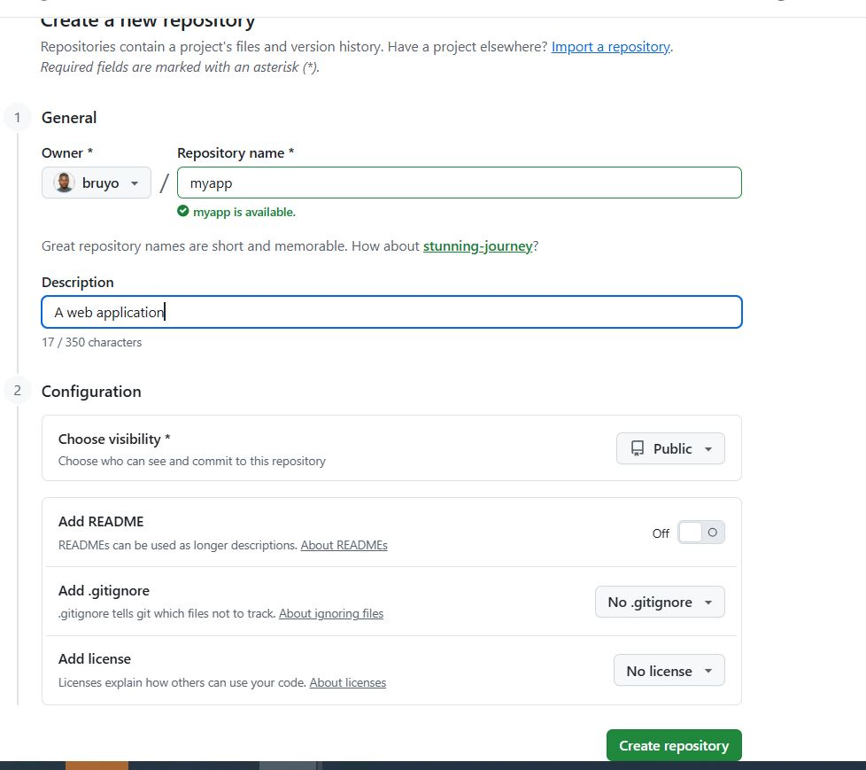
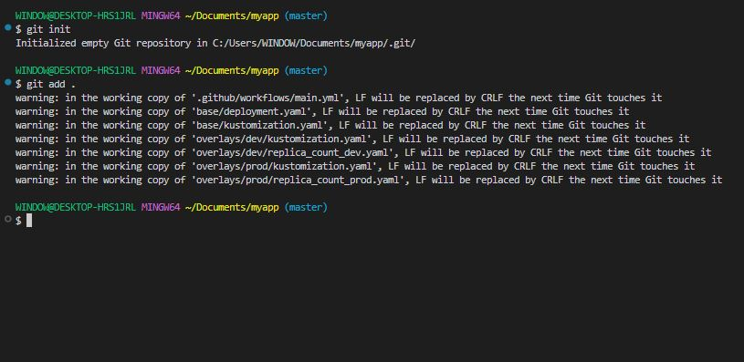
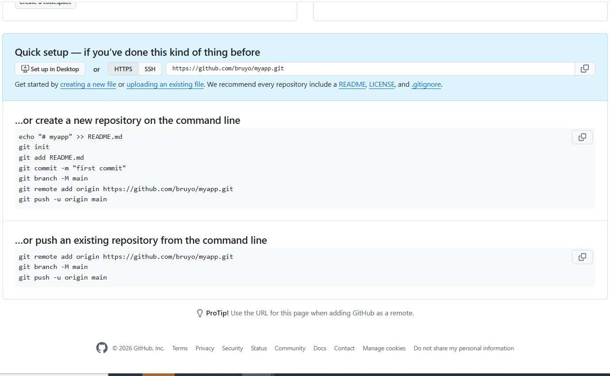
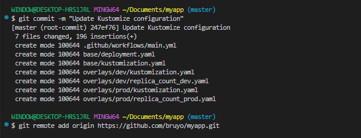
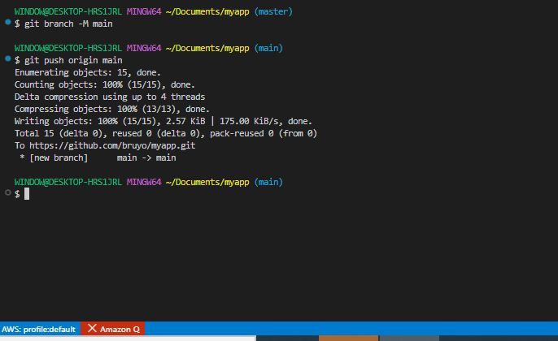
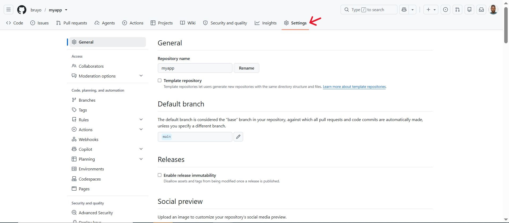
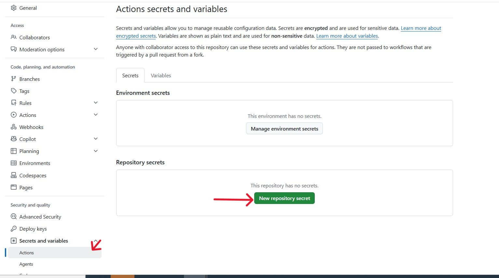
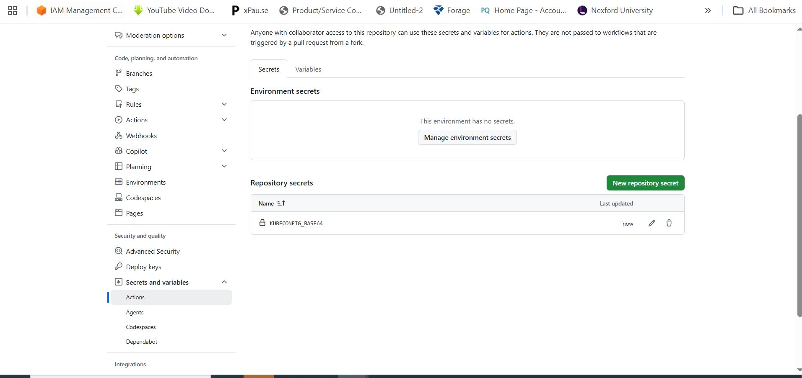
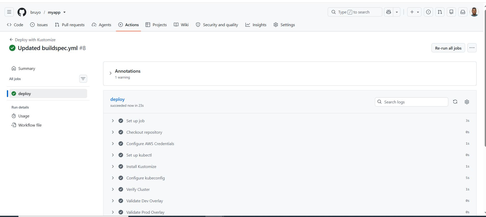
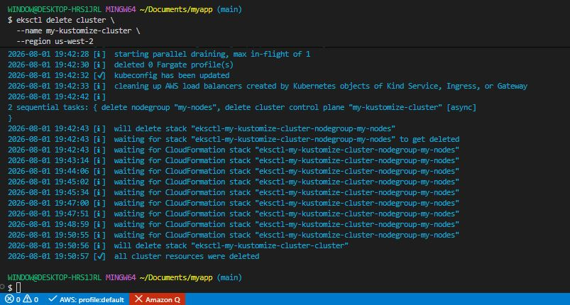

# Advanced Configuration Management with Kustomize and AWS

## Project Overview

In this project, we will gain practical experience in integrating Kustomize with AWS resources, managing secrets, and optimizing Kubernetes configurations for production environments.

### Project Tasks

**Integrating Kustomize into CI/CD Pipelines:**

1. Setting up GitHub Actions:

- GitHub Repository: Ensure that you have a GitHub repository for your Kubernetes project with kustomize configurations.

```bash
.github/workflows/
base/
overlays/
```

- GitHub Actions Workflow: Create a workflow file in your repository '.github/workflows/main.yml';

```bash
mkdir -p .github/workflows/

nano main.yml
```

**Configuring the CI/CD Pipeline:

1. Workflow Definition:

- Start by defining the name of the workflow and the trigger event.

```bash
name: Deploy with Kustomize
on:
  push:
    branches:
    - main
```

2. Defining the jobs:

- Define a job named 'deploy' that runs on an Ubuntu latest environment.

```bash
jobs:
  deploy:
    runs-on: ubuntu-latest
    steps:
```

3. Checking out code: 

- Use the 'actions/checkout@v2' action to check out your code to the GitHub Action runner.

```bash
- name: Checkout
  uses: actions/checkout@v2
```

4. Setting Up Kubectl and Kustomize:

- Set up 'kubectl' and 'kustomize' using respective GitHub Actions.

```bash
- name: Set up Kubectl
  uses: azure/setup-kubectl@v1
- name: Set up Kustomize
  uses: imranismail/setup-kustomize@v1
```

5. Applying Kustomize Configuration:

- Apply Kustomize configuration to your Kubernetes Cluster.

- Ensure your GitHub Actions runner is configured to communicate with your Kubernetes cluster.

```bash
- name: Deploy to Kubernetes
  run: |
    kubectl apply -k ./overlays/production/
```

Now your YAML file should look something like this:

```bash
# Example for GitHub Actions
name: Deploy with Kustomize
on:
  push:
    branches:
    - main
jobs:
  deploy:
    runs-on: ubuntu-latest
    steps:
    - name: Checkout
      uses: actions/checkout@v2
    - name: Set up Kubectl
      uses: azure/setup-kubectl@v1
    - name: Set up Kustomize
      uses: imranismail/setup-kustomize@v1
    - name: Deploy to Kubernetes
      run: |
        kubectl apply -k ./overlays/production/
```

Note: Ensure that your CI/CD platform has accces to your Kubernetes Cluster.

**Testing the CI/CD Pipeline:**

1. Make configuration changes:

- Modify Kustomize cinfiguration in your repository, such as changing the replica count in an overlay.

2. Commit and Push Changes:

- Commit your changes to the repository and push them to the main branch.

```bash
git add .
git commit -m "Update Kustomize configuration"
git push origin main
```

3. Observe Pipeline Execution:

- Go to the Actions tab in your GitHub repository.

- You should see the workflow running. Click on the workflow run to view the details and logs.

- Verify that the changes have been sucessfully applied to your Kubernetes cluster.

4. Advanced Steps:

- Adding Environment Variables: Configure environment variables or secrets in GitHub Actions for sensitive data cluster credentials.

- Enhanced Workflow Triggers: Customize the trigger for the workflow to run on pull requests, specific paths, or even tags.

**Handling Complex Configurations:**

1. Organize Configuration Structure:

- Structure your project to handle multiple applications or services.

- Use a hierarchical directory structure to organize configuration.

2. Use of Kustomize Features:

- Implement features like overlays, patches, and generators to manage variations across environments or applications.

**Best Practices and Tips:**

1. Performance Optimization:

- Implementing Caching in CI/CD pipelines:

- Use caching mechanisms provided by your CI/CD tools to cache Docker layers or dependencies.

- For GitHub Actions, use the 'actions/cache' action.

- For AWS CodePipeline, consider using Amazon S3 for caching artifacts.

```bash
- name: Cache Docker layers
  uses: actions/cache@v2
  with:
    path: /tmp/.buildx-cache
    key: ${{" runner.os "}}-buildx-${{" github.sha "}}
    restore-keys: |
      ${{" runner.os "}}-buildx-
```

- Optimizing Kustomise Configuration:

- Breakdown large Kustomize configurations into smaller, manageable units.

- Use base and overlay structures effectively to reuse components.

- Regularly review and refactor configurations for improvements.


**Avoiding Common Pitfalls:**

1. Using ConfigMaps and Secrets for Dynamic values:

- Avoid hardcoding values like image tags or environment-specific settings.

- Use 'ConfigMaps' and 'Secret' generator in Kustomize to manage these values.

- Encrypt sensitive data using tools like AWS Key Management Service (KMS) when storing in Secrets.

- In your 'kustomization.yaml' file, you can define a 'configMapGenerator' which creates a 'ConfigMap' from literal values or files.

```bash
# kustomization.yaml
configMapGenerator:
- name: my-app-config
  literals:
    - app_name=MyKustomizeApp
    - log_level=debug
```

- You can reference this 'ConfigMap' in your Kubernetes resource manifests (like a Deployment) to inject these configuration values.

```bash
# deployment.yaml
apiVersion: apps/v1
kind: Deployment
metadata:
  name: my-app
spec:
  template:
    spec:
      containers:
        - name: app-container
          image: myapp:latest
          envFrom:
            - configMapRef:
                name: my-app-config
```

- This example shows a deployment where the 'ConfigMap' is used to set environment variables in the container.

- Similarly, define a 'secretGenerator' in 'kustomization.yaml'. Note that literal values for secrets should be base64 encoded or sourced from files for better security.

```bash
# kustomization.yaml
secretGenerator:
- name: my-app-secret
  literals:
    - username=admin
    - password=VGhpc0lzU2VjcmV0IQ==  # base64 encoded value
```

- This configuration creates a 'Secret' named 'my-app-secret' with username and password data. 

- Reference the 'Secret' in your Kubernetes resource manifest.

```bash
# deployment.yaml
apiVersion: apps/v1
kind: Deployment
metadata:
  name: my-app
spec:
  template:
    spec:
      containers:
        - name: app-container
          image: myapp:latest
          envFrom:
            - secretRef:
                name: my-app-secret
```

- This deployment uses the 'Secret' to inject sensitive configuration data into the container environment.

2. Careful Management of Updates:

- Implement a review process for changes in configurations.

- Use GitOps practices for version controlling and reviewing changes before applying them.

- Test changes in a staging environment before applying them to production.


3. Leveraging Community Resources:

Engage with Community Forums: 

- Participate in discussions on platforms like Stack Overflow and Kubernetes Slack.

- Share experiences, ask questions, and learn from community insights.


**Using AWS:**

1. Deploying with Amazon EKS:

- Use Amazon EKS for a managed Kubernetes experience.

- Set up EKS using 'eksctl' or the AWS Management Console.

- Ensure AWS CLI is correctly configured for EKS cluster access.

2. Integrating AWS CodePipeline for CI/CD:

- Utilize AWS CodePipeline for a seamless CI/CD experience in AWS services.

- Configure CodePipeline to use kustomize for deployment steps.

- Integrate other AWS services like CodeCommit, CodeBuild, and CodeDeploy as needed.


### Project Implementation:

1. GitHub Actions CI/CD Pipeline:

- Create the workflow directory and file.

```bash
mkdir -p .github/workflows
```

```bash
cat > .github/workflows/main.yml << 'EOF'

name: Deploy with Kustomize

on:
  push:
    branches:
      - main

  pull_request:
    branches:
      - main

jobs:
  deploy:
    runs-on: ubuntu-latest

    steps:
      # -----------------------------------------------
      # Step 1 - Checkout source code
      # -----------------------------------------------
      - name: Checkout repository
        uses: actions/checkout@v4

      # -----------------------------------------------
      # Step 2 - Configure AWS Credentials
      # -----------------------------------------------
      - name: Configure AWS Credentials
        uses: aws-actions/configure-aws-credentials@v4
        with:
          aws-access-key-id: ${{ secrets.AWS_ACCESS_KEY_ID }}
          aws-secret-access-key: ${{ secrets.AWS_SECRET_ACCESS_KEY }}
          aws-region: us-west-2

      # -----------------------------------------------
      # Step 3 - Install kubectl
      # -----------------------------------------------
      - name: Set up kubectl
        uses: azure/setup-kubectl@v4
        with:
          version: latest

      # -----------------------------------------------
      # Step 4 - Install Kustomize
      # -----------------------------------------------
      - name: Install Kustomize
        uses: imranismail/setup-kustomize@v2
        with:
          kustomize-version: 5.4.1

      # -----------------------------------------------
      # Step 5 - Generate kubeconfig for EKS
      # -----------------------------------------------
      - name: Configure kubeconfig
        run: |
          aws eks update-kubeconfig \
            --region us-west-2 \
            --name my-kustomize-cluster

      # -----------------------------------------------
      # Step 6 - Verify Kubernetes Connection
      # -----------------------------------------------
      - name: Verify Cluster
        run: |
          kubectl config current-context
          kubectl cluster-info
          kubectl get nodes

      # -----------------------------------------------
      # Step 7 - Validate Kustomize overlays
      # -----------------------------------------------
      - name: Validate Dev Overlay
        run: |
          kustomize build overlays/dev

      - name: Validate Prod Overlay
        run: |
          kustomize build overlays/prod

      # -----------------------------------------------
      # Step 8 - Deploy Development Overlay
      # -----------------------------------------------
      - name: Deploy Development
        if: github.ref == 'refs/heads/main'
        run: |
          kubectl apply -k overlays/dev

      # -----------------------------------------------
      # Step 9 - Deploy Production Overlay
      # -----------------------------------------------
      - name: Deploy Production
        if: github.ref == 'refs/heads/main'
        run: |
          kubectl apply -k overlays/prod

      # -----------------------------------------------
      # Step 10 - Verify Deployment
      # -----------------------------------------------
      - name: Verify Deployment
        run: |
          kubectl get deployments
          kubectl get pods
          kubectl get services
          kubectl get configmaps
          kubectl get secrets

      # -----------------------------------------------
      # Step 11 - Display Rollout Status
      # -----------------------------------------------
      - name: Check Rollout
        run: |
          kubectl rollout status deployment/my-app -n default || true
EOF
```         
          
- Updated base/kustomization.yaml:

```bash
cat > base/kustomization.yaml << 'EOF'

# base/kustomization.yaml
apiVersion: kustomize.config.k8s.io/v1beta1
kind: Kustomization

resources:
  - deployment.yaml

# ConfigMap from literal values
configMapGenerator:
  - name: my-app-config
    literals:
      - app_name=MyKustomizeApp
      - log_level=debug
      - key1=value1
      - key2=value2

# Secret generator
secretGenerator:
  - name: my-app-secret
    literals:
      - username=admin
      - password=VGhpc0lzU2VjcmV0IQ==   # base64 encoded
EOF
```

3. Updated base/deployment.yaml:

```bash
cat > base/deployment.yaml << 'EOF'

# base/deployment.yaml
apiVersion: apps/v1
kind: Deployment
metadata:
  name: nginx-deployment
  labels:
    app: nginx
spec:
  replicas: 2
  selector:
    matchLabels:
      app: nginx
  template:
    metadata:
      labels:
        app: nginx
    spec:
      containers:
        - name: app-container
          image: nginx:1.14.2
          ports:
            - containerPort: 80

          # Inject ConfigMap as environment variables
          envFrom:
            - configMapRef:
                name: my-app-config    # references configMapGenerator

          # Inject Secret as environment variables
          env:
            - name: USERNAME
              valueFrom:
                secretKeyRef:
                  name: my-app-secret
                  key: username
            - name: PASSWORD
              valueFrom:
                secretKeyRef:
                  name: my-app-secret
                  key: password

          resources:
            requests:
              memory: "64Mi"
              cpu: "50m"
            limits:
              memory: "128Mi"
              cpu: "100m"
EOF
```

4. Store Kubeconfig as GitHub Secret:

- Create GitHub repository for 'myapp':



```bash
git init
git add .
git commit -m "Update Kustomize configuration"
git remote add origin https://github.com/bruyo/myapp.git
git branch -M main
git push origin main
```













- Generate the base64 encoded kubeconfig:

```bash
# In Git Bash
cat ~/.kube/config | base64
```



5. Test the Pipeline:

- Make a configuration change 'overlays/dev/replica_count_dev.yaml':

```bash
# Change replica count in dev overlay
cat > overlays/dev/replica_count_dev.yaml << 'EOF'
apiVersion: apps/v1
kind: Deployment
metadata:
  name: nginx-deployment
spec:
  replicas: 4    # changed from 3 to 4
EOF
```

```bash
git add .
git commit -m "Update replica count in dev overlay"
git push origin main
```

6. AWS CodePipeline Integration:

```bash
nano buildspec.yml
```

```bash
# buildspec.yml for AWS CodeBuild
cat > buildspec.ymll << 'EOF'
version: 0.2

phases:
  install:
    commands:
      # Install kubectl
      - curl -LO "https://dl.k8s.io/release/$(curl -L -s https://dl.k8s.io/release/stable.txt)/bin/linux/amd64/kubectl"
      - chmod +x kubectl
      - mv kubectl /usr/local/bin/

      # Install kustomize
      - curl -s "https://raw.githubusercontent.com/kubernetes-sigs/kustomize/master/hack/install_kustomize.sh" | bash
      - mv kustomize /usr/local/bin/

  pre_build:
    commands:
      # Configure EKS access
      - aws eks update-kubeconfig --name my-kustomize-cluster --region us-west-2

  build:
    commands:
      # Validate
      - kustomize build overlays/dev/
      - kustomize build overlays/prod/

  post_build:
    commands:
      # Deploy
      - kubectl apply -k overlays/dev/
      - kubectl get deployments
      - kubectl get pods
EOF
```

- Create EKS cluster:

```bash
aws eks describe-cluster \
  --name my-kustomize-cluster \
  --region us-west-2 \
  --query 'cluster.status'
```



**Clean Up**

- Delete the EKS Cluster:

```bash
eksctl delete cluster \
  --name my-kustomize-cluster \
  --region us-west-2
```

