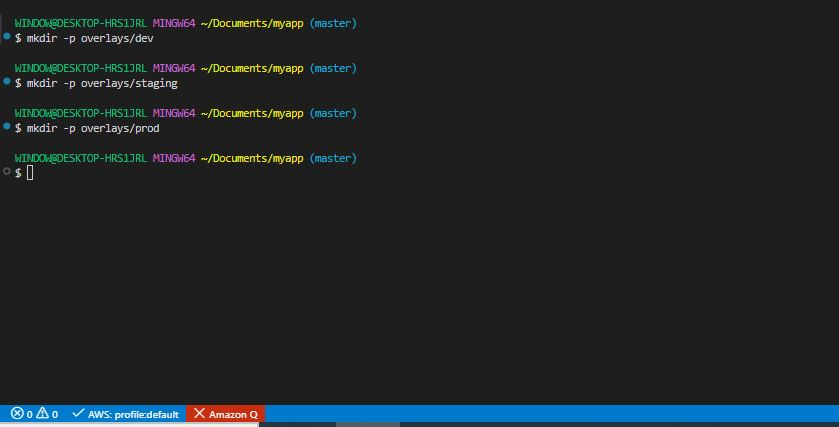
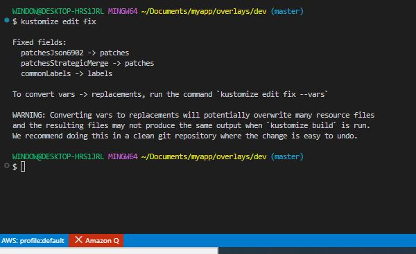
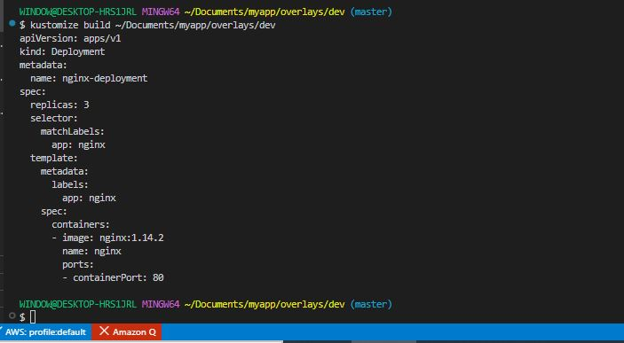
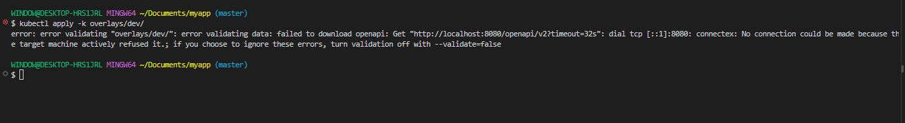
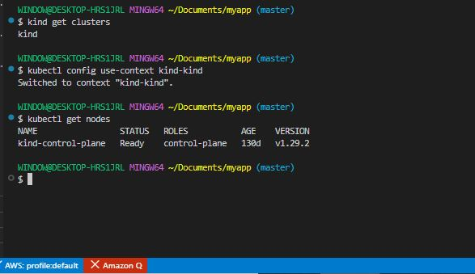
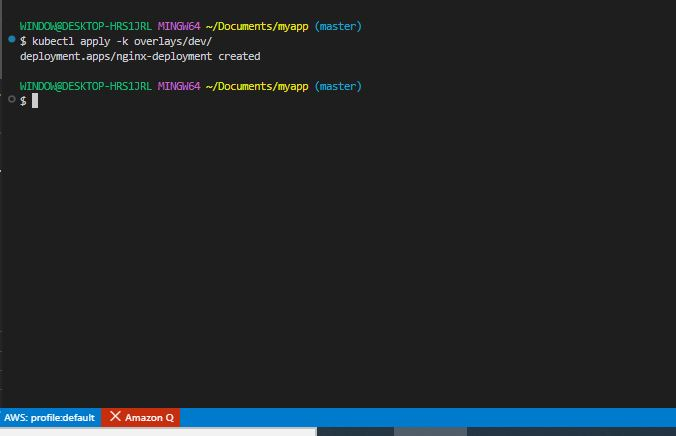
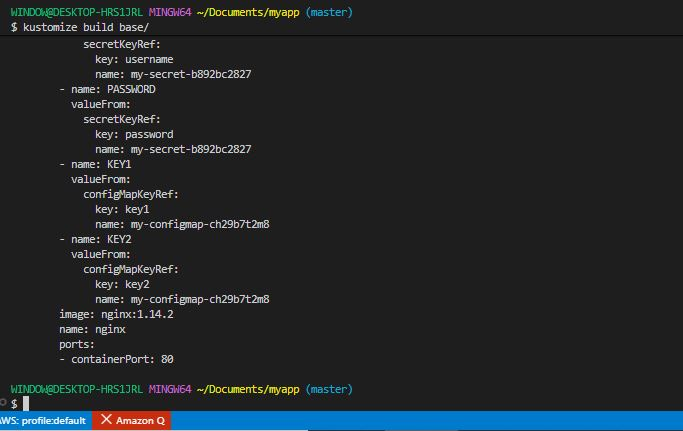
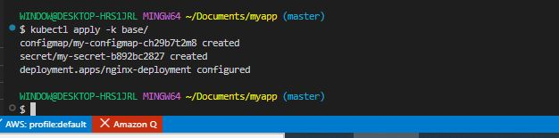
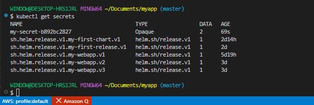

# Advanced Kustomize Features

## Project Overview

In this project, we will explore advanced features of Kustomize, such as overlays, transformations, and generators, for more sophisticated customization of Kubernetes configuration.

### The importance of Advanced Kustomize Features
Think of Kustomize as an artist's toolkit when painting different versions of a masterpiece for various clients. Each client requires a unique adaptation, similar to how different environments (development, staging, production) in Kubernetes need specific configurations. Overlays allow for these tailored adjustments, transformers and generators act as your fine tools for detailed modifications, and managing Secrets and ConfigMaps is akin to protecting the unique, sensitive elements of your art. This advanced section empowers you to craft and secure Kubernetes configurations with precision and flexibility, an essential skill for any Kubernetes practitioner.

### Project Tasks

**Working with Overlays**

1. Creating Environment-Specific Directories:

- In the project's 'overlays' directory, create subdirectories for each environment.

```bash
mkdir -p overlays/dev
mkdir -p overlays/staging
mkdir -p overlays/prod
```



2. Setting up Environment Configurations:

- Each environment will have its own 'kustomization.yaml' file to specify unique customization.

- Inside 'overlays/dev/kustomization.yaml', you might specify development-specific settings.

```bash
nano kustomization.yaml
```

```bash
# overlays/dev/kustomization.yaml
apiVersion: kustomize.config.k8s.io/v1beta1
kind: Kustomization

resources:                        # ✅ replaces 'bases'
  - ../../base

patches:                          # ✅ replaces 'patchesStrategicMerge'
  - path: replica_count_dev.yaml
```

'replica_count_dev.yaml' can be used to alter the number of replicas in the development environment.


```bash
nano replica_count_dev.yaml
```

```bash
apiVersion: apps/v1
kind: Deployment
metadata:
  name: nginx-deployment
spec:
  replicas: 3
```

or

```bash
cat > ~/Documents/myapp/overlays/dev/replica_count_dev.yaml << 'EOF'
apiVersion: apps/v1
kind: Deployment
metadata:
  name: nginx-deployment
spec:
  replicas: 3
EOF
```

- Auto-fix deprecation warnings

```bash
kustomize edit fix
```



- Preview:

```bash
kustomize build ~/Documents/myapp/overlays/dev
```



3. Applying Overlays for Each Environment:

- Use Kustomize to apply configurations for a specific environment. Go back to project directory.

```bash
kubectl apply -k overlays/dev/
```


The kustomize build works but kubectl can't connect to a cluster. Your kubeconfig is pointing to localhost:8080 instead of a real cluster.

**Let's fix it**

- Use Kind cluster:

```bash
# Check Kind cluster is running
kind get clusters

# Update kubeconfig to use Kind
kubectl config use-context kind-kind

# Verify connection
kubectl get nodes
```



- Apply the kustomize overlay:

```bash
kubectl apply -k overlays/dev/
```




**Transformers and Generators**

1. Customizing labels for Production Environment:

- In 'overlays/prod/kustomization.yaml', use 'commonLabels' to add labels to all resources for easy identification.

```bash
cd ~/Documents/myapp/overlays/prod/
```

```bash
nano kustomization.yaml
```

```bash
# overlays/prod/kustomization.yaml
apiVersion: kustomize.config.k8s.io/v1beta1
kind: Kustomization

resources:
  - ../../base                    # Relative path to the base directory

commonLabels:
  env: production                 # Label applied to every resource

patches:
  - path: replica_count_prod.yaml # Patch file to merge with the base
```

- Create overlays/prod/replica_count_prod.yaml

```bash
nano replica_count_prod.yaml
```

```bash
apiVersion: apps/v1
kind: Deployment
metadata:
  name: nginx-deployment          # Must match name in base/deployment.yaml
spec:
  replicas: 5                     # More replicas for production
```

2. Implementing Name Prefixes:

- adding prefix to resource names helps in distinguishing resources across different environments.

- Update file:

```bash
nano kustomization.yaml
```

```bash
# overlays/prod/kustomization.yaml
apiVersion: kustomize.config.k8s.io/v1beta1
kind: Kustomization

resources:
  - ../../base                      # Relative path to the base directory

namePrefix: prod-                   # Prefix added to the name of all resources

commonLabels:
  env: production                   # Label applied to every resource

patches:
  - path: replica_count_prod.yaml   # Patch file to merge with the base
```

```bash
nano replica_count_prod.yaml
```

```bash
apiVersion: apps/v1
kind: Deployment
metadata:
  name: nginx-deployment            # ← base name without prefix
spec:
  replicas: 5
```

**Secret and ConfigMap Management**

1. Generating a ConfigMap:

- In the base 'kustomization.yaml', use 'configMapGenerator' to create a ConfigMap from literal values.

- Updated base/kustomization.yaml

```bash
nano kustomization.yaml
```

```bash
# base/kustomization.yaml
apiVersion: kustomize.config.k8s.io/v1beta1
kind: Kustomization

resources:
  - deployment.yaml             # List of resource files to include

configMapGenerator:
  - name: my-configmap          # Name of the ConfigMap
    literals:
      - key1=value1             # Key-value pairs
      - key2=value2
```

- Use the ConfigMap in base/deployment.yaml

```bash
nano deployment.yaml
```

```bash
spec:
  containers:
    - name: myapp
      image: nginx:1.14.2
      env:
        - name: KEY1
          valueFrom:
            configMapKeyRef:
              name: my-configmap  # reference ConfigMap
              key: key1
        - name: KEY2
          valueFrom:
            configMapKeyRef:
              name: my-configmap
              key: key2
```

2. Creating Secrets Safely:

- Use 'secretGenerator' to generate Secrets. Ensure sensitive data like passwords are encoded or externally managed.

- Updated base/kustomization.yaml:

```bash
nano kustomization.yaml
```

```bash
# base/kustomization.yaml
apiVersion: kustomize.config.k8s.io/v1beta1
kind: Kustomization

resources:
  - deployment.yaml               # List of resource files to include

configMapGenerator:
  - name: my-configmap            # Name of the ConfigMap
    literals:
      - key1=value1               # Key-value pairs
      - key2=value2

secretGenerator:
  - name: my-secret               # Name of the Secret
    literals:
      - username=admin            # Key-value pairs
      - password=s3cr3t           # Consider external management for real secrets
```

- Use the Secret in base/deployment.yaml:

```bash
nano deployment.yaml
```

```bash
apiVersion: apps/v1
kind: Deployment
metadata:
  name: nginx-deployment
  labels:
    app: nginx
spec:
  replicas: 2
  selector:
    matchLabels:
      app: nginx
  template:
    metadata:
      labels:
        app: nginx
    spec:
      containers:
        - name: nginx
          image: nginx:1.14.2
          ports:
            - containerPort: 80
          env:
            - name: USERNAME
              valueFrom:
                secretKeyRef:
                  name: my-secret
                  key: username
            - name: PASSWORD
              valueFrom:
                secretKeyRef:
                  name: my-secret
                  key: password
            - name: KEY1
              valueFrom:
                configMapKeyRef:
                  name: my-configmap
                  key: key1
            - name: KEY2
              valueFrom:
                configMapKeyRef:
                  name: my-configmap
                  key: key2
```

**Note:** For actual projects, use secure methods to inject these values, like environment variables or secret management tools.

**Applying Configurations:**

- Deploy these configurations as part of the base or specific overlays depending on the use case.

```bash
cd ~/Documents/myapp

# Preview first
kustomize build base/

# Apply
kubectl apply -k base/

# Check secret was created
kubectl get secrets
kubectl describe secret my-secret
```





