# Configuration Management with Helm

## Project Overview

In this project, we will embark on a journey to introduce you to the basics of Helm Charts and their integration with Jenkins. As a DevOps Engineer, your goal is to design and implement a simplified CI/CD pipeline using Jenkins, with a primary focus on Helm Charts. The objective is to automate the deployment of a basic web application, promoting understanding and hands-on experience for those new to the field.

### Project Tasks

**Jenkins Server Setup**

In our previous project (Integrating Helm with Jenkins), we documented how to install and setup a Jenkins Server.

- Basic security measures applied to Jenkins Server setup.

1. Secure Jenkins Admin Account

```bash
Jenkins → Manage Jenkins → Security
→ Security Realm: Jenkins own user database
→ Authorization: Matrix-based security
→ Save
```

Change default admin password:

```bash
Jenkins → Admin (top right) → Configure
→ Password → enter new strong password
→ Save
```

2. Enable CSRF Protection

```bash
Jenkins → Manage Jenkins → Security
→ CSRF Protection → Enable
→ Crumb Issuer: Default Crumb Issuer
→ Save
```

3. Disable Anonymous Access

```bash
Jenkins → Manage Jenkins → Security
→ Authorization → Matrix-based security
→ Remove all permissions from Anonymous
→ Save
```

4. Install Security Plugins

```bash
Jenkins → Manage Jenkins → Plugins → Available
→ Search and install:

✅ OWASP Markup Formatter
✅ Credentials Binding
✅ Role-based Authorization Strategy
✅ Audit Trail
✅ Git Forensics
```

5. Configure Role-Based Access Control

```bash
Jenkins → Manage Jenkins → Manage and Assign Roles
→ Manage Roles → Add roles:
```

```bash
Role        Permissions
─────────────────────────────────────────
admin       All permissions
developer   Build, Read, Workspace
viewer      Read only
```

```bash
→ Assign Roles → assign users to roles
→ Save
```

6. Secure Credentials Storage

Never hardcode secrets in Jenkinsfile. Store them in Jenkins credentials:

```bash
Jenkins → Manage Jenkins → Credentials
→ System → Global credentials
→ Add Credentials:

Kind: Secret text
ID: aws-access-key
Secret: your-secret-value
```

Use in Jenkinsfile:

```bash
pipeline {
    agent any
    stages {
        stage('Deploy') {
            steps {
                withCredentials([
                    string(credentialsId: 'aws-access-key',
                           variable: 'AWS_ACCESS_KEY'),
                    string(credentialsId: 'aws-secret-key',
                           variable: 'AWS_SECRET_KEY')
                ]) {
                    bat 'helm upgrade --install my-webapp . --namespace default'
                }
            }
        }
    }
}
```

7. Enable Jenkins Audit Trail

```bash
Jenkins → Manage Jenkins → System
→ Audit Trail → Add Logger
→ Log Location: C:\ProgramData\Jenkins\audit.log
→ Log File Size: 100MB
→ Log File Count: 5
→ Save
```

8. Restrict Script Approval

```bash
Jenkins → Manage Jenkins → In-process Script Approval
→ Review and approve only trusted scripts
→ Deny unknown or suspicious scripts
```

9. Set Up Jenkins Behind a Reverse Proxy

Configure Nginx as a reverse proxy with HTTPS:

```bash
server {
    listen 80;
    server_name jenkins.yourdomain.com;
    return 301 https://$host$request_uri;
}

server {
    listen 443 ssl;
    server_name jenkins.yourdomain.com;

    ssl_certificate     /etc/ssl/certs/jenkins.crt;
    ssl_certificate_key /etc/ssl/private/jenkins.key;

    location / {
        proxy_pass         http://localhost:8080;
        proxy_set_header   Host $host;
        proxy_set_header   X-Real-IP $remote_addr;
        proxy_set_header   X-Forwarded-For $proxy_add_x_forwarded_for;
        proxy_set_header   X-Forwarded-Proto $scheme;
    }
}
```

10. Keep Jenkins Updated

```bash
Jenkins → Manage Jenkins → In-process Script Approval
→ Review and approve only trusted scripts
→ Deny unknown or suspicious scripts
```

**Helm Charts Basics**

**What is Helm?**

Think of Helm as the app store for Kubernetes. Just like you install apps on your phone with one tap, Helm lets you install complex applications on Kubernetes with one command.

```bash
Without Helm:                        With Helm:
kubectl apply -f deployment.yaml
kubectl apply -f service.yaml        helm install my-app ./my-chart
kubectl apply -f ingress.yaml
kubectl apply -f configmap.yaml
kubectl apply -f secret.yaml
```

**Key Concepts**

1. Chart

A Chart is a package of Kubernetes resources — like a zip file containing everything needed to run an application.

```bash
my-chart/
├── Chart.yaml          ← chart information
├── values.yaml         ← default configuration
└── templates/          ← Kubernetes resource templates
    ├── deployment.yaml
    ├── service.yaml
    └── ingress.yaml
```

2. Release

A Release is a running instance of a chart. You can install the same chart multiple times with different names:

```bash
# Same chart, two different releases
helm install my-app-dev  ./my-chart    # development release
helm install my-app-prod ./my-chart    # production release
```

3. Repository

A Repository is where charts are stored and shared — like GitHub but for Helm charts:

```bash
# Add popular repositories
helm repo add stable https://charts.helm.sh/stable
helm repo add bitnami https://charts.bitnami.com/bitnami

# Search for charts
helm search repo wordpress
helm search repo nginx
```

4. Values

Values are the configuration settings for your chart. They make charts reusable across environments:

```bash
# values.yaml — defaults
replicaCount: 1
image:
  repository: nginx
  tag: latest
service:
  type: ClusterIP
  port: 80
```

Override values at install time:

```bash
# Override specific values
helm install my-app ./my-chart \
  --set replicaCount=3 \
  --set image.tag=v2.0

# Or use a custom values file
helm install my-app ./my-chart \
  --values production-values.yaml
```

5. Templates

Templates are Kubernetes YAML files with placeholders that get filled in from values.yaml:

```bash
# templates/deployment.yaml
apiVersion: apps/v1
kind: Deployment
metadata:
  name: {{ .Release.Name }}-app      # filled at runtime
spec:
  replicas: {{ .Values.replicaCount }} # from values.yaml
  template:
    spec:
      containers:
        - name: {{ .Chart.Name }}
          image: "{{ .Values.image.repository }}:{{ .Values.image.tag }}"
```

The {{ }} syntax is Go templating — Helm replaces these with real values when you run helm install.


**Hands-On Guide — Create Your First Helm Chart**

- Create the chart structure

```bash
helm create my-first-chart
cd my-first-chart
```

This generates:

```bash
my-first-chart/
├── Chart.yaml
├── values.yaml
├── charts/             ← dependency charts
└── templates/
    ├── deployment.yaml
    ├── service.yaml
    ├── ingress.yaml
    ├── hpa.yaml
    ├── serviceaccount.yaml
    ├── NOTES.txt
    └── _helpers.tpl    ← reusable template snippets
```

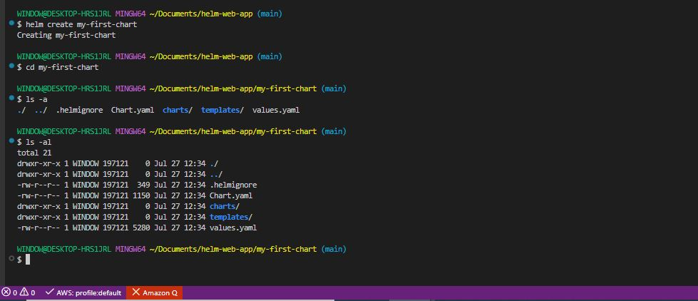

- Edit Chart.yaml

```bash
nano Chart.yaml
```

```bash
apiVersion: v2
name: my-first-chart
description: My first Helm chart — a simple nginx web server
type: application
version: 0.1.0          # chart version
appVersion: "1.0.0"     # app version
maintainers:
  - name: bruyo
    email: brucebruyo@email.com
```

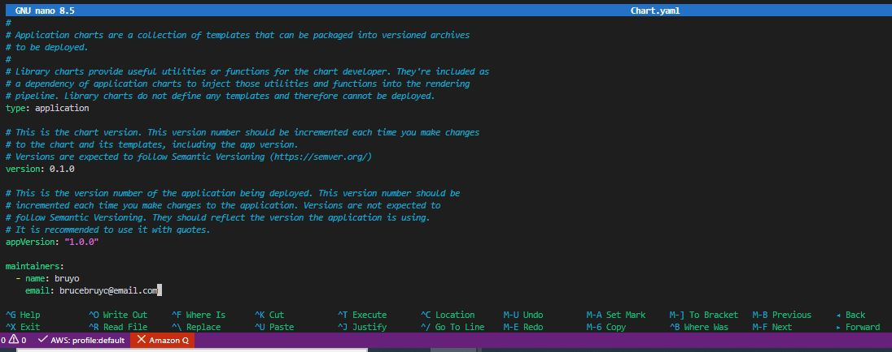

- Edit values.yaml

```bash
nano values.yaml
```

```bash
# Number of pod replicas
replicaCount: 1

# Docker image settings
image:
  repository: nginx
  pullPolicy: IfNotPresent
  tag: "latest"

# Service settings
service:
  type: ClusterIP
  port: 80

# Resource limits
resources:
  requests:
    memory: "64Mi"
    cpu: "50m"
  limits:
    memory: "128Mi"
    cpu: "100m"

# Custom settings for our app
app:
  title: "My First Helm App"
  environment: "development"
  message: "Hello from Helm!"
```

- Edit templates/deployment.yaml

```bash
cd templates

nano deployment.yaml
```

```bash
apiVersion: apps/v1
kind: Deployment
metadata:
  name: {{ .Release.Name }}-{{ .Chart.Name }}
  labels:
    app: {{ .Chart.Name }}
    release: {{ .Release.Name }}
    environment: {{ .Values.app.environment }}
spec:
  replicas: {{ .Values.replicaCount }}
  selector:
    matchLabels:
      app: {{ .Chart.Name }}
      release: {{ .Release.Name }}
  template:
    metadata:
      labels:
        app: {{ .Chart.Name }}
        release: {{ .Release.Name }}
    spec:
      containers:
        - name: {{ .Chart.Name }}
          image: "{{ .Values.image.repository }}:{{ .Values.image.tag }}"
          imagePullPolicy: {{ .Values.image.pullPolicy }}
          ports:
            - containerPort: 80
          resources:
            {{- toYaml .Values.resources | nindent 12 }}
          env:
            - name: APP_TITLE
              value: {{ .Values.app.title | quote }}
            - name: APP_ENV
              value: {{ .Values.app.environment | quote }}
            - name: APP_MESSAGE
              value: {{ .Values.app.message | quote }}
```

- Edit templates/service.yaml

```bash
cd templates

nano service.yaml
```

```bash
apiVersion: v1
kind: Service
metadata:
  name: {{ .Release.Name }}-{{ .Chart.Name }}
  labels:
    app: {{ .Chart.Name }}
    release: {{ .Release.Name }}
spec:
  type: {{ .Values.service.type }}
  ports:
    - port: {{ .Values.service.port }}
      targetPort: 80
      protocol: TCP
  selector:
    app: {{ .Chart.Name }}
    release: {{ .Release.Name }}
```

- Validate the chart

```bash
cd my-first-chart
```

```bash
# Check for syntax errors
helm lint my-first-chart

# Preview generated YAML without installing
helm template my-first-chart ./my-first-chart

# Dry run — simulates install
helm install my-first-chart ./my-first-chart --dry-run
```

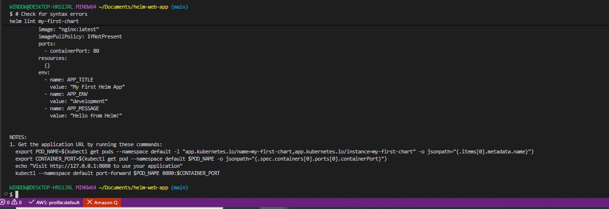

- Install the chart

```bash
# Install with default values
helm install my-first-release ./my-first-chart

# Install with custom values
helm upgrade my-first-release ./my-first-chart \
  --set replicaCount=2 \
  --set app.environment=production \
  --set app.message="Hello from Production!"
```

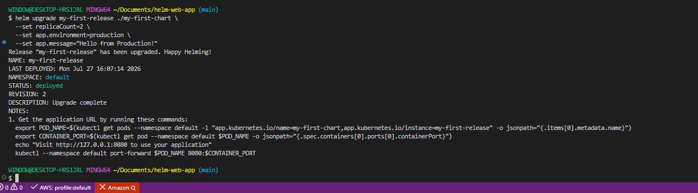

- Verify the deployment

```bash
# List all releases
helm list

# Check release status
helm status my-first-release

# Check pods are running
kubectl get pods

# Check service
kubectl get service
```

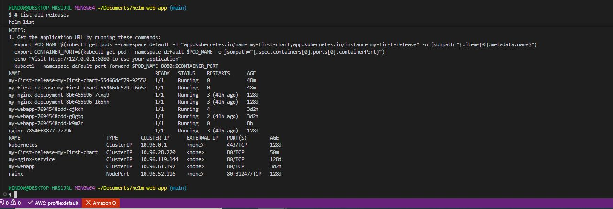

- Upgrade the release

```bash
# Change replica count
helm upgrade my-first-release ./my-first-chart \
  --set replicaCount=3

# Check history
helm history my-first-release
```

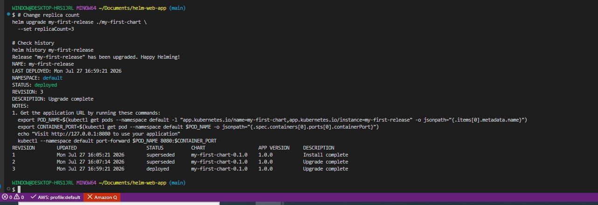

- Rollback if something goes wrong

```bash
# Roll back to revision 1
helm rollback my-first-release 1

# Verify rollback
helm history my-first-release
```

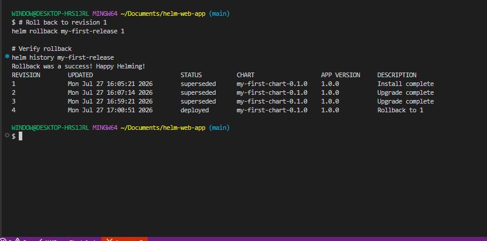

- Uninstall

```bash
helm uninstall my-first-release
```

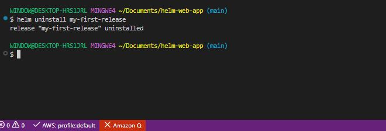

**Integrating Helm with Jenkins**

1. GitHub repository setup:

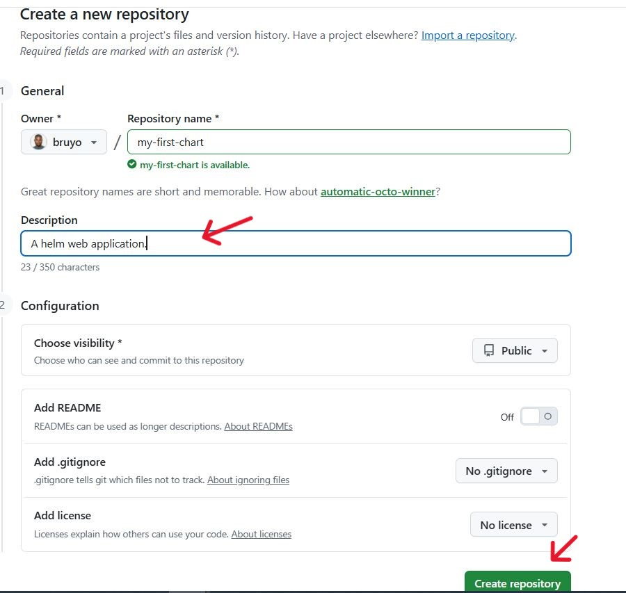

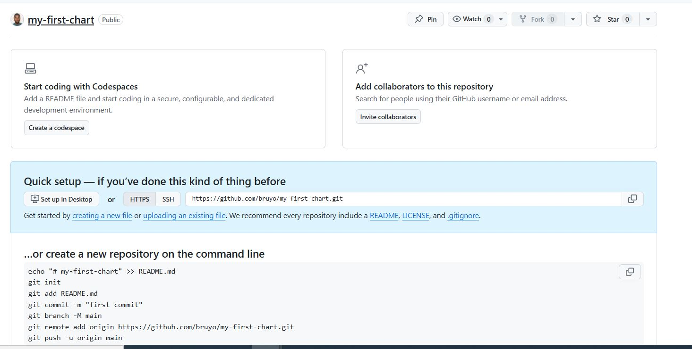

```bash
git add .

git commit -m "my first chart web application"

git remote set-url origin https://github.com/bruyo/my-first-chart.git

git push
```

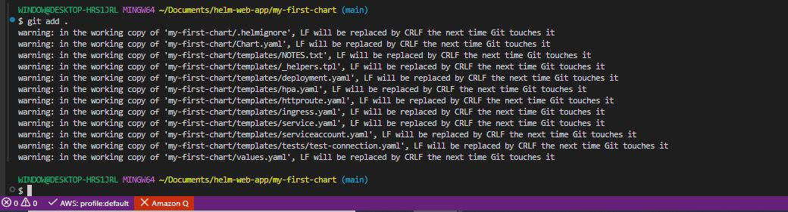

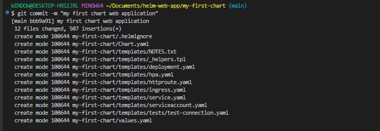

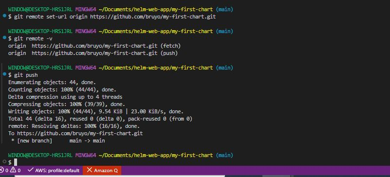


2. Jenkins setup:

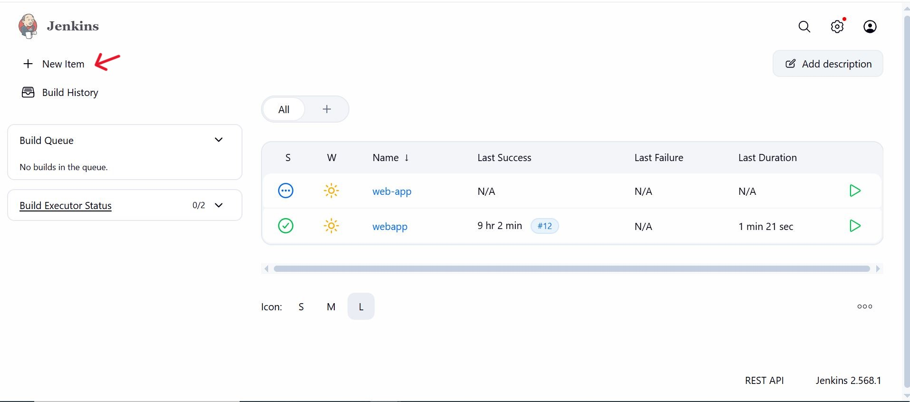

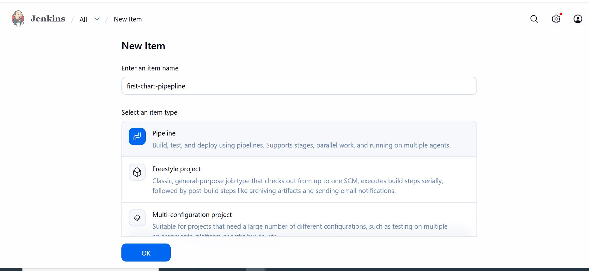

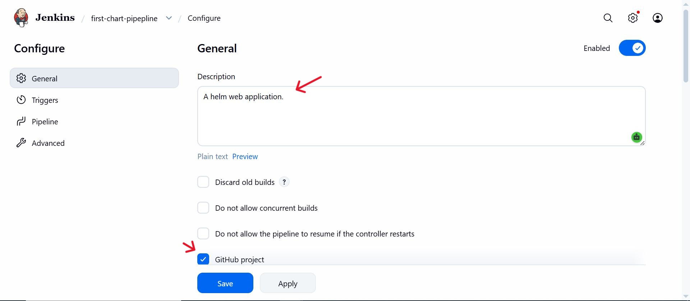


```bash
https://github.com/bruyo/my-first-chart.git
```

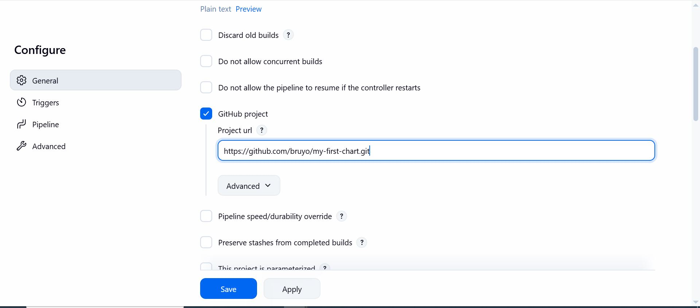

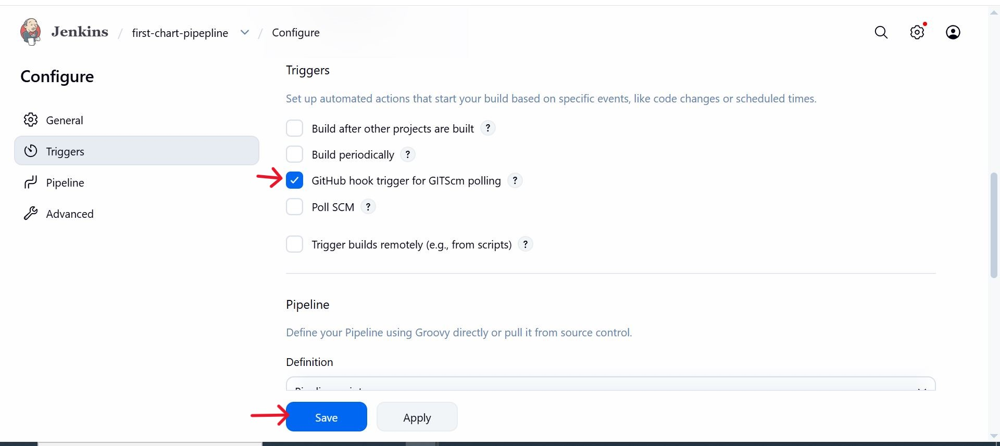

- Create a Jenkinsfile

```bash
pipeline {
    agent any
    environment {
        KUBECONFIG = "C:\\ProgramData\\Jenkins\\.jenkins\\.kube\\config"
    }
    stages {
        stage('Verify Cluster') {
            steps {
                bat 'kubectl cluster-info'
                bat 'kubectl get nodes'
            }
        }
        stage('Deploy with Helm') {
            steps {
                dir('my-first-chart') {
                    bat 'helm upgrade --install my-first-release . --namespace default'
                }
            }
        }
    }
}
```

- Build with Jenkins.

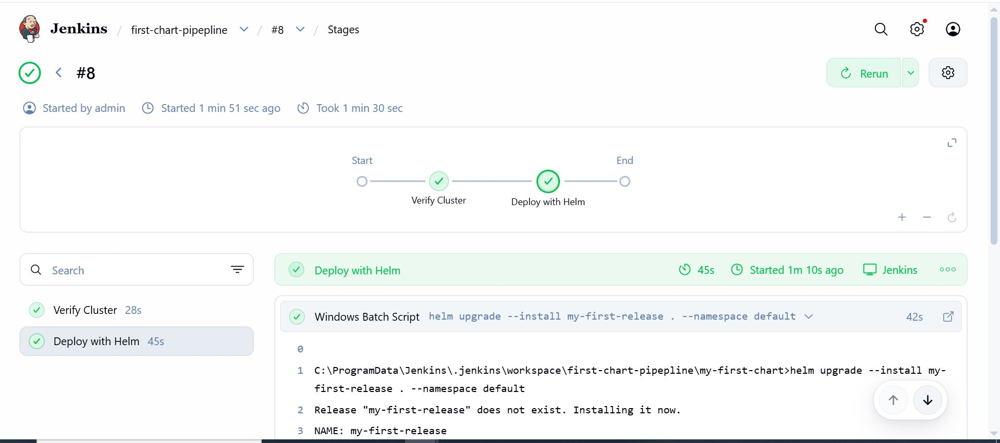