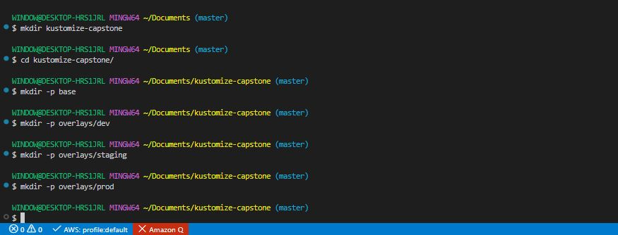
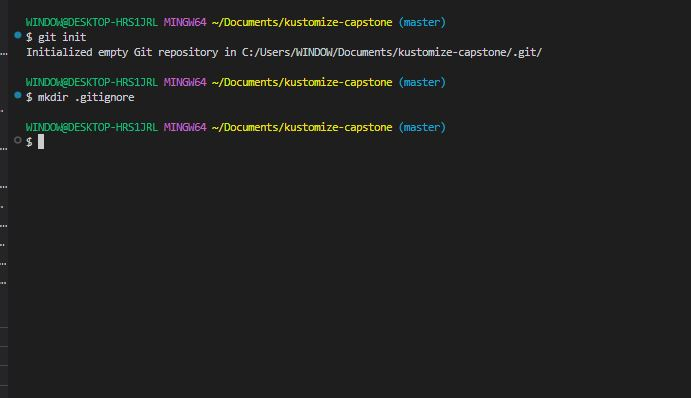
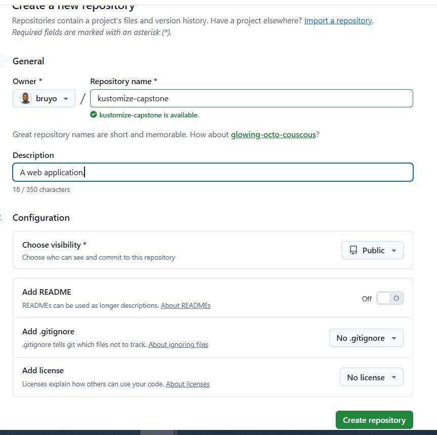
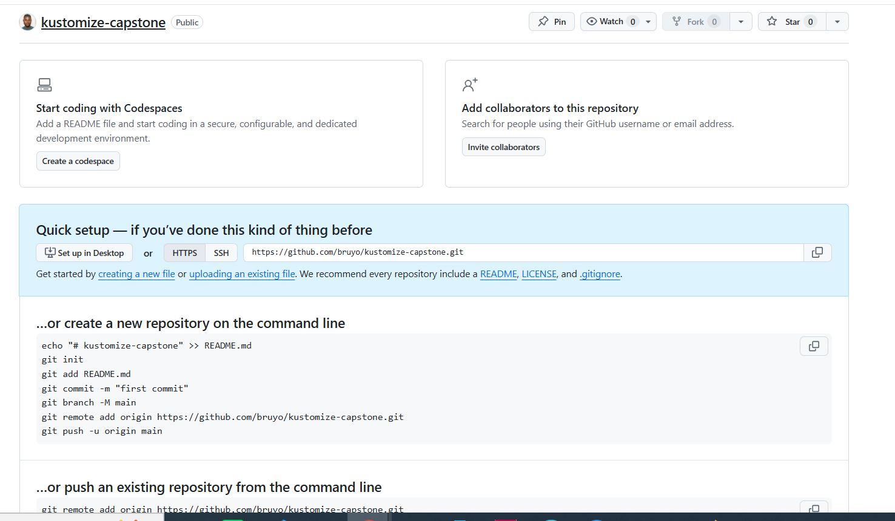
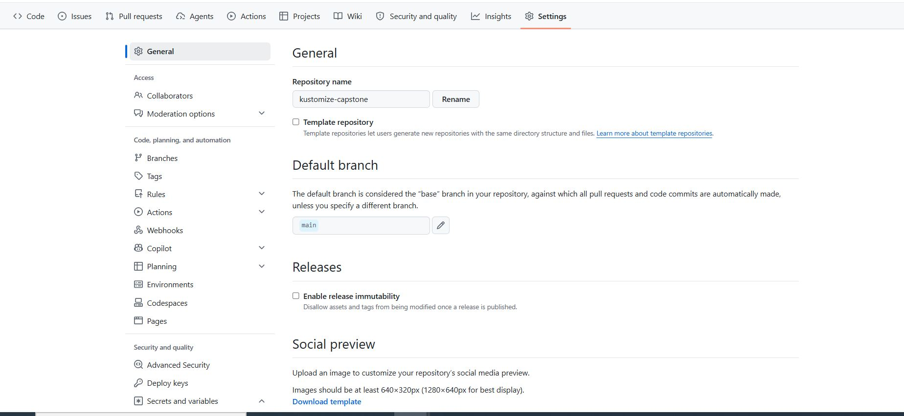
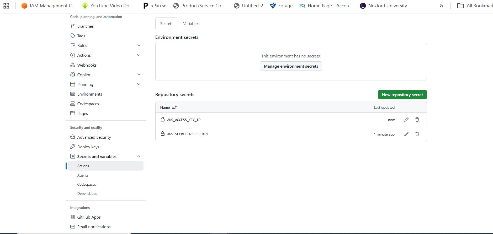
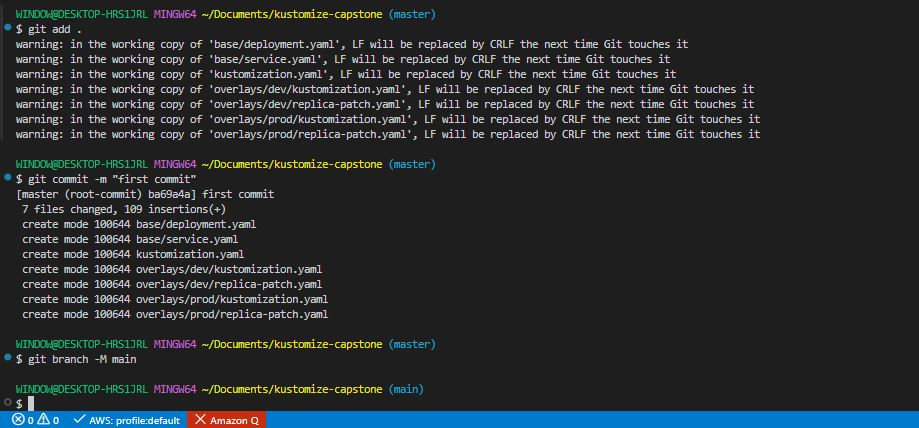
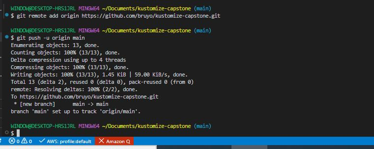
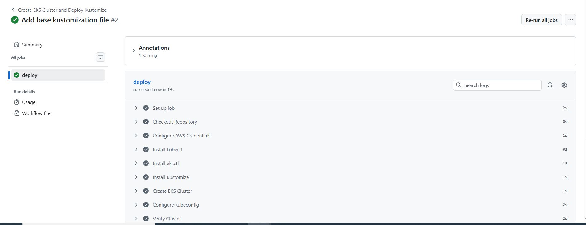
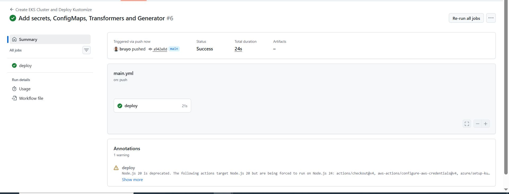

# Implementing a Multi-Environment Application Deployment with Kustomize

## Project Overview

In this project, we will be tasked with deploying a web application in a Kubernetes environment. The application will have different configurations for development, staging, and production environments. The goal is to utilize Kustomize to manage these configurations efficiently and integrate the process into a CI/CD Pipeline.

### Project Structure

```bash
kustomize-capstone/
├── base/
│   ├── deployment.yaml
│   ├── service.yaml
│   └── kustomization.yaml
└── overlays/
    ├── dev/
    │   └── kustomization.yaml
    └── staging/
    │   └── kustomization.yaml
    └── prod/
        └── kustomization.yaml
```

### Project Tasks

**Set up the project:**

- Create a new project directory named 'kustomize-capstone'.

```bash
mkdir kustomize-capstone
```

- Inside the directory, structure it with Kustomize conventions: 'base/' and 'overlays/' (subdirectories for 'dev', 'staging', 'prod').



**Initialize Git:**

- Initialize a Git repository in your 'kustomize-capstone' directory.

```bash
git init
```

- Create a '.gitignore' file to exclude unnecessary files.




**Define Base Configuration**

- In the 'base/' directory, define Kubernetes resources like Deployment, Service, etc., for the web application.

For base/deployment.yaml:

```bash
cat > base/deployment.yaml << 'EOF'
apiVersion: apps/v1
kind: Deployment
metadata:
  name: webapp
  labels:
    app: webapp
spec:
  replicas: 1
  selector:
    matchLabels:
      app: webapp
  template:
    metadata:
      labels:
        app: webapp
    spec:
      containers:
      - name: webapp
        image: nginx:latest
        ports:
        - containerPort: 80
EOF
```

For base/service.yaml:

```bash
cat > base/service.yaml << 'EOF'
apiVersion: v1
kind: Service
metadata:
  name: webapp-service
spec:
  selector:
    app: webapp
  ports:
    - protocol: TCP
      port: 80
      targetPort: 80
  type: ClusterIP
EOF
```

- Create a 'kustomization.yaml' file in 'base/' to incude these resources.

```bash
cat > base/kustomization.yaml << 'EOF'
apiVersion: kustomize.config.k8s.io/v1beta1
kind: Kustomization

resources:
  - deployment.yaml
  - service.yaml
EOF
```

**Create Environment-Specific Overlays:**

- In each subdirectory of 'overlays/', create a 'kustomization.yaml' that customizes the base configuration for that environment.

- Implement variations for each environment (e.g resource limits, different replica counts, or environment variables).

For overlays/dev/kustomization.yaml:

```bash
cat > overlays/dev/kustomization.yaml << 'EOF'

apiVersion: kustomize.config.k8s.io/v1beta1
kind: Kustomization

resources:
  - ../../base

labels:
  - pairs:
      environment: development

patches:
  - path: replica-patch.yaml
EOF
```

For overlays/dev/replica-patch.yaml:

```bash
cat > overlays/dev/replica-patch.yaml << 'EOF'

apiVersion: apps/v1
kind: Deployment
metadata:
  name: webapp
spec:
  replicas: 1
  template:
    spec:
      containers:
      - name: webapp
        env:
        - name: APP_ENV
          value: development
        resources:
          requests:
            cpu: "100m"
            memory: "128Mi"
          limits:
            cpu: "200m"
            memory: "256Mi"
EOF
```

For overlays/prod/kustomization.yaml:

```bash
cat > overlays/prod/kustomization.yaml << 'EOF'

apiVersion: kustomize.config.k8s.io/v1beta1
kind: Kustomization

resources:
  - ../../base

nameSuffix: -prod

commonLabels:
  environment: production

patches:
  - path: replica-patch.yaml
EOF
```

For overlays/prod/replica-patch.yaml:

```bash
cat > overlays/prod/replica-patch.yaml << 'EOF'

apiVersion: apps/v1
kind: Deployment
metadata:
  name: webapp
spec:
  replicas: 3
  template:
    spec:
      containers:
      - name: webapp
        env:
        - name: APP_ENV
          value: production
        resources:
          requests:
            cpu: "250m"
            memory: "256Mi"
          limits:
            cpu: "500m"
            memory: "512Mi"
EOF
```

**Integrate with a CI/CD Pipeline:**

- Choose a CI/CD platform (e.g GitHub Actions, Jenkins)

- Set up a pipeline that deploys the application using kustomize. The pipeline should trigger on code changes.






- Create a .github/workflows/main.yml:

```bash
mkdir -p .github/workflows/
```

```bash
cat > .github/workflows/main.yml << 'EOF'

name: Create EKS Cluster and Deploy Kustomize

on:
  workflow_dispatch:
  push:
    branches:
      - main

env:
  AWS_REGION: us-west-2
  CLUSTER_NAME: my-kustomize-cluster

jobs:
  deploy:
    runs-on: ubuntu-latest

    steps:
      # ---------------------------------------------
      # Checkout Repository
      # ---------------------------------------------
      - name: Checkout Repository
        uses: actions/checkout@v4

      # ---------------------------------------------
      # Configure AWS Credentials
      # ---------------------------------------------
      - name: Configure AWS Credentials
        uses: aws-actions/configure-aws-credentials@v4
        with:
          aws-access-key-id: ${{ secrets.AWS_ACCESS_KEY_ID }}
          aws-secret-access-key: ${{ secrets.AWS_SECRET_ACCESS_KEY }}
          aws-region: ${{ env.AWS_REGION }}

      # ---------------------------------------------
      # Install kubectl
      # ---------------------------------------------
      - name: Install kubectl
        uses: azure/setup-kubectl@v4
        with:
          version: latest

      # ---------------------------------------------
      # Install eksctl
      # ---------------------------------------------
      - name: Install eksctl
        run: |
          curl --silent --location \
          "https://github.com/eksctl-io/eksctl/releases/latest/download/eksctl_$(uname -s)_amd64.tar.gz" \
          | tar xz

          sudo mv eksctl /usr/local/bin

          eksctl version

      # ---------------------------------------------
      # Install Kustomize
      # ---------------------------------------------
      - name: Install Kustomize
        uses: imranismail/setup-kustomize@v2
        with:
          kustomize-version: 5.4.1

      # ---------------------------------------------
      # Create EKS Cluster (if it doesn't already exist)
      # ---------------------------------------------
      - name: Create EKS Cluster
        run: |
          if eksctl get cluster --name $CLUSTER_NAME --region $AWS_REGION; then
            echo "Cluster already exists."
          else
            eksctl create cluster \
              --name $CLUSTER_NAME \
              --region $AWS_REGION \
              --nodes 3 \
              --node-type t3.medium \
              --managed
          fi

      # ---------------------------------------------
      # Configure kubectl
      # ---------------------------------------------
      - name: Configure kubeconfig
        run: |
          aws eks update-kubeconfig \
            --region $AWS_REGION \
            --name $CLUSTER_NAME

      # ---------------------------------------------
      # Verify Cluster
      # ---------------------------------------------
      - name: Verify Cluster
        run: |
          kubectl config current-context
          kubectl get nodes

      # ---------------------------------------------
      # Validate Kustomize
      # ---------------------------------------------
      - name: Validate Kustomize
        run: |
          kustomize build overlays/dev
          kustomize build overlays/prod

      # ---------------------------------------------
      # Deploy Development
      # ---------------------------------------------
      - name: Deploy Dev
        run: |
          kubectl apply -k overlays/dev

      # ---------------------------------------------
      # Deploy Production
      # ---------------------------------------------
      - name: Deploy Production
        run: |
          kubectl apply -k overlays/prod

      # ---------------------------------------------
      # Verify Deployment
      # ---------------------------------------------
      - name: Verify Deployment
        run: |
          kubectl get deployments
          kubectl get services
          kubectl get pods
EOF
```

- Add the secret:






```bash
git add .
git commit -m "first commit"
git branch -M main
git remote add origin https://github.com/bruyo/kustomize-capstone.git
git push -u origin main
```






**Test the CI/CD Pipeline:**

- Make changes in the kustomize configurations and push to repository.

- Verify that the CI/CD pipeline correctly applies these changes to a Kubernetes cluster.



**Manage Secrets and ConfigMaps:**

- Use kustomize to generate ConfigMaps and Secrets. Ensure sensitive data is handled securely.

- Apply these configurations in the overlays for different environments.

**Implement Transformers and Generators:**

- Use advanced features of kustomize such as transformers and generators to refine the configurations.

- Demonstrate usage like adding common labels, annotations, and managing dynamic data with generators.


- Update base/deployment.yaml:

Modify the container so it uses the generated ConfigMap and Secret.

```bash
cat > base/deployment.yaml << 'EOF'

apiVersion: apps/v1
kind: Deployment
metadata:
  name: kustomize-capstone
spec:
  replicas: 1
  selector:
    matchLabels:
      app: kustomize-capstone
  template:
    metadata:
      labels:
        app: kustomize-capstone
    spec:
      containers:
      - name: kustomize-capstone
        image: nginx:latest
        ports:
        - containerPort: 80
        envFrom:
        - configMapRef:
            name: app-config
        - secretRef:
            name: app-secret
EOF
```

- Update 'overlays/dev/replica-patch.yaml':

```bash
cat > overlays/dev/replica-patch.yaml << 'EOF'

apiVersion: apps/v1
kind: Deployment
metadata:
  name: kustomize-capstone
spec:
  replicas: 1
  template:
    spec:
      containers:
      - name: kustomize-capstone
        env:
        - name: APP_ENV
          value: development
        resources:
          requests:
            cpu: "100m"
            memory: "128Mi"
          limits:
            cpu: "200m"
            memory: "256Mi"
EOF
```

- Update base/kustomization.yaml:

```bash
cat > base/kustomization.yaml << 'EOF'

apiVersion: kustomize.config.k8s.io/v1beta1
kind: Kustomization

resources:
  - deployment.yaml
  - service.yaml

transformers:
  - labels-transformer.yaml
EOF
```

- Create a Transformer 'base/labels-transformer.yaml':

```bash
cat > base/labels-transformer.yaml << 'EOF'

apiVersion: builtin
kind: LabelTransformer
metadata:
  name: common-labels

labels:
  app.kubernetes.io/name: kustomize-capstone
  app.kubernetes.io/managed-by: kustomize

fieldSpecs:
- path: metadata/labels
  create: true
EOF
```

- Create 'overlays/dev/app.properties':

```bash
cat > overlays/dev/app.properties << 'EOF'

APP_NAME=Kustomize Capstone
APP_ENV=development
APP_MESSAGE=Running Development Environment
EOF
```

- Create 'overlays/dev/secret.env':

```bash
cat > overlays/dev/secret.env << 'EOF'

DB_USERNAME=devuser
DB_PASSWORD=devpassword123
EOF
```

- Update 'overlays/dev/kustomization.yaml':

```bash
cat > overlays/dev/kustomization.yaml << 'EOF'

apiVersion: kustomize.config.k8s.io/v1beta1
kind: Kustomization

resources:
- ../../base

nameSuffix: -dev

labels:
- pairs:
    environment: development

patches:
- path: replica-patch.yaml

configMapGenerator:
- name: app-config
  envs:
  - app.properties

secretGenerator:
- name: app-secret
  envs:
  - secret.env

generatorOptions:
  disableNameSuffixHash: true

commonAnnotations:
  environment: development
EOF
```

- Create 'overlays/prod/app.properties':

```bash
cat > overlays/prod/app.properties << 'EOF'

APP_NAME=Kustomize Capstone
APP_ENV=production
APP_MESSAGE=Running Production Environment
EOF
```

- Create 'overlays/prod/secret.env':

```bash
cat > overlays/prod/secret.env << 'EOF'

DB_USERNAME=produser
DB_PASSWORD=StrongPassword123
EOF
```

- Update 'overlays/prod/kustomization.yaml':

```bash
cat > overlays/prod/kustomization.yaml << 'EOF'

apiVersion: kustomize.config.k8s.io/v1beta1
kind: Kustomization

resources:
- ../../base

nameSuffix: -prod

labels:
- pairs:
    environment: production

patches:
- path: replica-patch.yaml

configMapGenerator:
- name: app-config
  envs:
  - app.properties

secretGenerator:
- name: app-secret
  envs:
  - secret.env

generatorOptions:
  disableNameSuffixHash: true

commonAnnotations:
  environment: production
EOF
```

- Update 'overlays/prod/replica-patch.yaml':

```bash
cat > overlays/prod/replica-patch.yaml << 'EOF'

apiVersion: apps/v1
kind: Deployment
metadata:
  name: kustomize-capstone
spec:
  replicas: 3
EOF
```

- Update 'base/service.yaml':

```bash
cat > base/service.yaml << 'EOF'

apiVersion: v1
kind: Service

metadata:
  name: kustomize-capstone-service

spec:
  selector:
    app: kustomize-capstone

  ports:
    - protocol: TCP
      port: 80
      targetPort: 80

  type: ClusterIP
EOF
```

