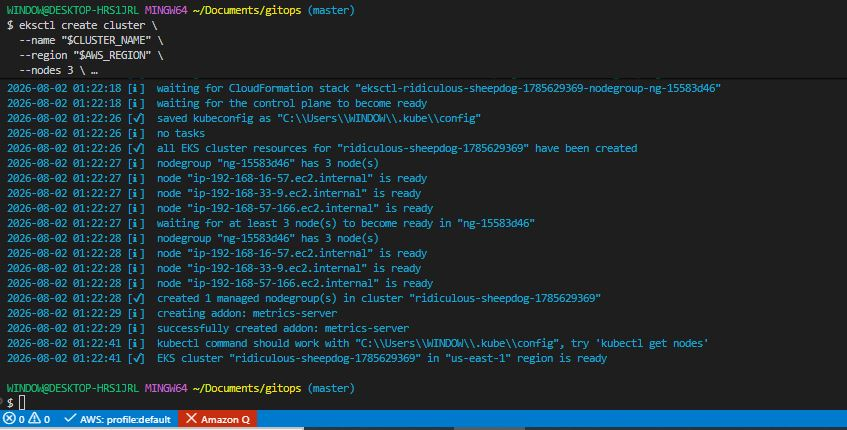

# Introduction to GitOps and ArgoCD 

## Project Overview:

In this project, we will explore the fundamentals of GitOps and ArgoCD, a popular tool for continuous delivery and deployment in Kubernetes environments. Through this hands-on exercises, we will learn how to set up Git repositories, define declarative configurations, and automate application deployments using ArgoCD.

**Introduction to the GitOps and ArgoCD**

Imagine you're the conductor of an orchestra, where each musician represents a component of a Kubernetes Cluster. Just as a conductor ensures harmony and synchrony among the different musicians, GitOps using ArgoCD harmonizes and synchronizes the Kubernetes deployments. In this analogy, the musical score is the Git repository, holding the 'desired state' of the applications. ArgoCD acts like your brain, interpreting the score and guiding the orchestra (your kubernetes cluster) to perform as intended, adjusting in real-time to maintain the symphony (or desired state).


### Project Tasks

**GitOps Principles and the Role of ArgoCD**

1. Study GitOps Principles:

Key Concepts:

- Infrastructure as Code (IaC): Understand how infrastructure is managed and provisioned through code, rather than manual processes.

- Automated Deployment: Learn about the automated processes that ensures deployments are consistent and repeatable.

- Merge Requests for Change Management: Discover how changes are reviewed and merged, ensuring a controlled and traceable approach to environment modifications.

Benefits of GitOps:

- Enhanced Developer Productivity: Due to automated, predicable deployments.

- Improved Stability: As the entire system state is version-controlled.

- Easier Recovery: The ability to revert a previous state is simplified.

2. Role of ArgoCD in GitOps:

Automating Kubernetes Deployments:

- Understand how ArgoCD automates the deployment of applications to Kubernetes clusters by monitoring Git repositories.

- ArgoCD continuously compares the desired application state in Git with the live state in Kubernetes, ensuring consistency.

Feautures of ArgoCD:

- Declarative Setup: ArgoCD uses a declarative approach for infrastructure and application deployment.

- Self-healimg: Automatic correction of detected drifts in the desired and live states.

- Multi-Cluster Management: Manage deployments across multiple Kubernetes clusters.

- Integration with Various Tools: Works with Helm, Kustomize, and others for configuration management.

**Installing and Configuring ArgoCD in an AWS Kubernetes Environment**

1. Set up an EKS Cluster:

- Use AWS Management Console or AWS CLI to create an EKS Cluster.

- Create a new project directory named 'gitops'.

```bash
mkdir gitops
```

```bash
eksctl create cluster \
  --name "$CLUSTER_NAME" \
  --region "$AWS_REGION" \
  --nodes 3 \
  --node-type t3.medium \
  --managed
```



2. Install ArgoCD on EKS:

```bash
kubectl create namespace argocd

kubectl apply -n argocd -f https://raw.githubusercontent.com/argoproj/argo-cd/stable/manifests/install.yaml
```


Explanation: The code snippet creates a namespace for ArgoCD and then applies the ArgoCD manifests to EKS cluster.

3. Access ArgoCD UI on EKS:

- Use kubectl port-forwarding or set up an ingress controller to access the ArgoCD UI.

- Code snippet for port-forwarding:

```bash
kubectl port-forward svc/argocd-server -n argocd 8080:443
```

Explanation: This forwards port 8080 of your local machine to port 443 of the ArgoCD server, allowing access via 'localhost:8080'.

**ArgoCD Architexture: Understanding Core components**

1. Explore ArgoCD Componenets:

- Understand the functions of API server, Repository server, and Application Controller.

2. Navigate ArgoCD UI:

- Familarize yourself with viewing applications, managing repositories, and monitoring deployments through the ArgoCD UI.

3. Deploy a Sample Application:

- Use a public Git repository with Kubernetes manifests to deploy an application via ArgoCD.

4. Monitor Synchronization:

- Observe how ArgoCD syncs the desired state from the Git repository to the EKS cluster.