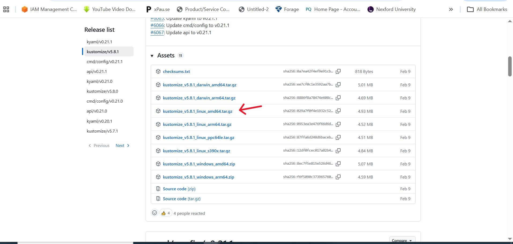
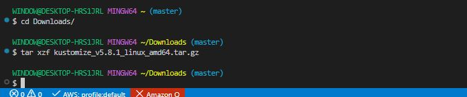
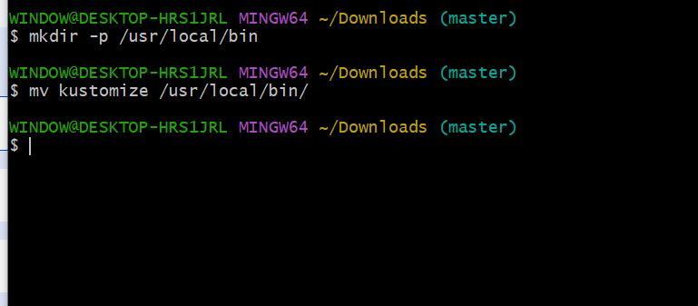
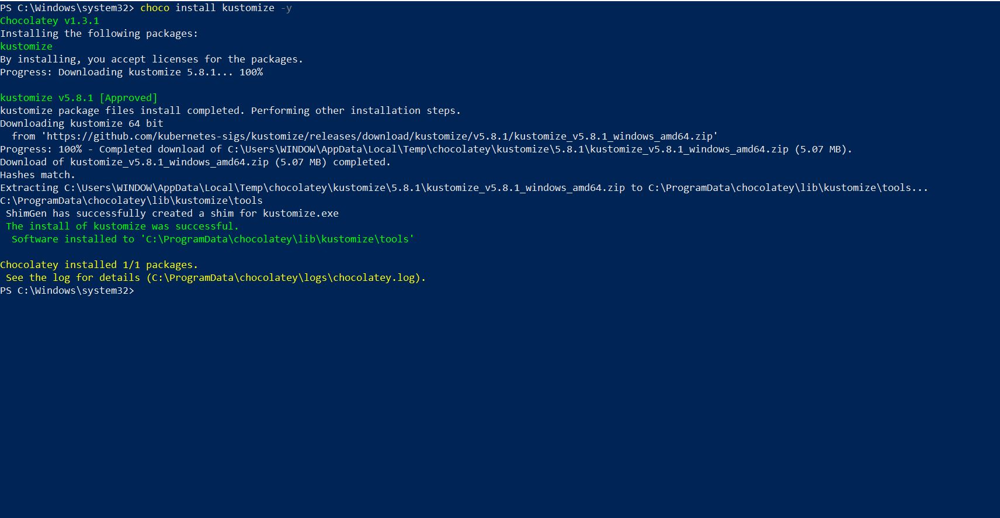
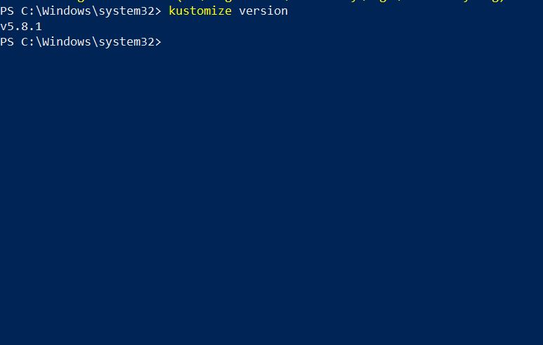
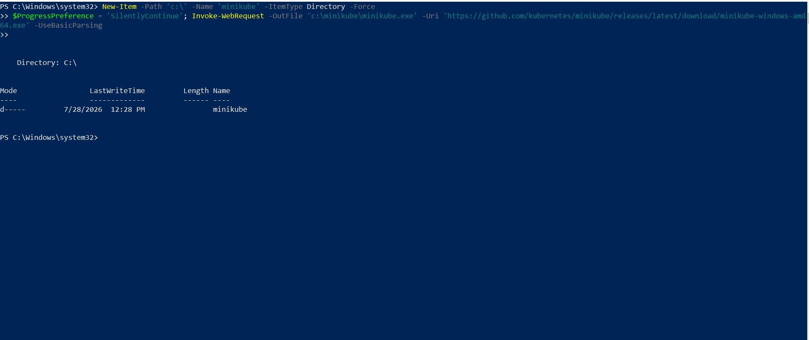
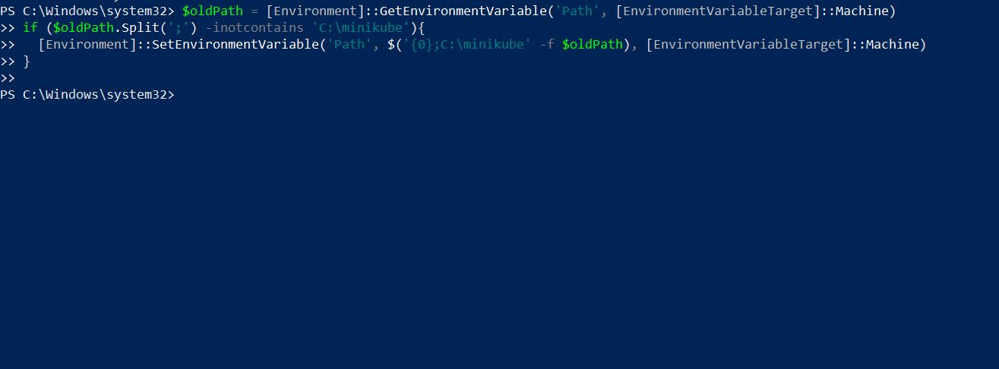
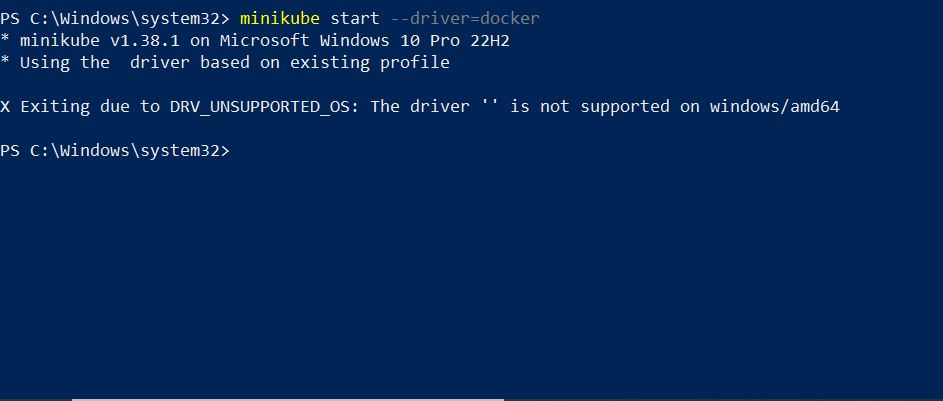
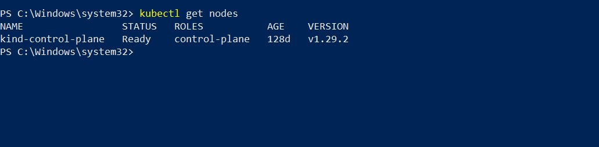
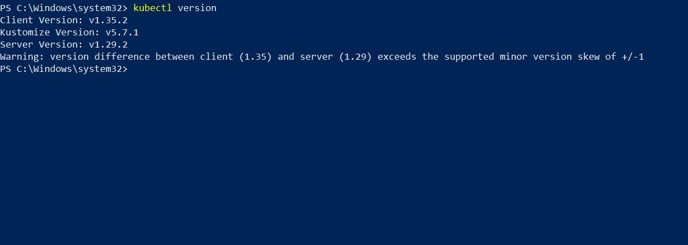

# Introduction to Kustomize

## Project Overview

In this project, we will learn the fundamentals of Kustomize, a tool for customizing Kubernetes configurations without modifying the original YAML files. Through practical exercises, we will learn how to create overlays, patches, and environment-specific configurations to manage application deployments efficiently.

### Introduction to Configuration Management in Kubernetes with Kustomize

Imagine building a house. This process involves various stages, from laying the foundation to the final touches. In this analogy, Kubernetes is the foundation and structure of the house, while Kustomize is like the interior design tool that allows you to customize each room according to specific needs without altering the underlying structure. Just as interior design transforms a generic structure into a functional and personalized space, Kustomize transforms basic Kubernetes setups into tailored environments that suit specific application requirements.

### Project Tasks

**Understanding Kubernetes Configuration**

- Create a file named **'mypod.yaml'**.

```bash
nano mypod.yaml
```

- Insert the following content.

```bash
apiVersion: v1
kind: Pod
metadata:
  name: mypod
spec:
  containers:
  - name: mycontainer
    image: nginx
```

The file defines a Kubernetes Pod named 'mypod' with a single container running the NGINX image.

**Setting up the Environment**

1. Visit the Kustomize GitHub releases Page. 

-Open your web browser and go to https://github.com/kubernetes-sigs/kustomize/releases



2. Select the appropriate version.

- Choose the version that is suitable for your Linux operating system. Look for a file that ends with **'linux_amd64.tar.gz'**.

3. Download the **'tar.gz'** file.

- Click on the link for the **'linux_amd64.tar.gz'** file to download it.


4. Open Terminal.

- Open your Terminal application.

5. Navigate to the Download Directory.

- Use 'cd' command to navigate to the directory where the downloaded file is located.

```bash
cd ~/Downloads
```

6. Extract the file.

- Run the command: 

```bash
tar xzf kustomize_v5.8.1_linux_amd64.tar.gz
```

Replace 'X.Y.Z' with the version number downloaded.

- This command will extract the Kustomize executable.



7. Move Kustomize to Your PATH:

- Move the extracted 'kustomize' file to a directory in your PATH for a easy access. The '/usr/local/bin' directory is a common choice.

```bash
mkdir -p /usr/local/bin

mv kustomize /usr/local/bin/
```



8. Check Kustomize Installation.

- Verify the installation by typing 'kustomize version' in the terminal.

```bash
kustomize version
```

For Windows:

On Powershell, run;

```bash
choco install kustomize -y
```



- To verify;

```bash
kustomize version
```




**Set up a Mini Kubernetes Cluster with Minikube**

1. Install Minikube

- Visit https://minikube.sigs.k8s.io/docs/start/?arch=%2Fwindows%2Fx86-64%2Fstable%2F.exe+download

- Follow the detailed instructions provided for your specific operating system.

For Windows:

On Powershell;

```bash
New-Item -Path 'c:\' -Name 'minikube' -ItemType Directory -Force
$ProgressPreference = 'SilentlyContinue'; Invoke-WebRequest -OutFile 'c:\minikube\minikube.exe' -Uri 'https://github.com/kubernetes/minikube/releases/latest/download/minikube-windows-amd64.exe' -UseBasicParsing
```



- Add the minikube.exe binary to your PATH. Make sure to run PowerShell as Administrator.

```bash
$oldPath = [Environment]::GetEnvironmentVariable('Path', [EnvironmentVariableTarget]::Machine)
if ($oldPath.Split(';') -inotcontains 'C:\minikube'){
  [Environment]::SetEnvironmentVariable('Path', $('{0};C:\minikube' -f $oldPath), [EnvironmentVariableTarget]::Machine)
}
```



2. Start Minikube

- Open terminal.

```bash
minikube start --driver=docker
```



3. Verify Minikube Installation:

- Once Minikube starts, verify the cluster is up and running with the command 

```bash
kubectl get nodes
```



**Verification Task**

1. Check Kustomize Version:

```bash
kustomize version
```


2. Check kubectl version:

```bash
kubectl version
```



### Conclusion:

We have finally successfully installed Kustomize and set up a basic Kubernetes cluster using Minikube.