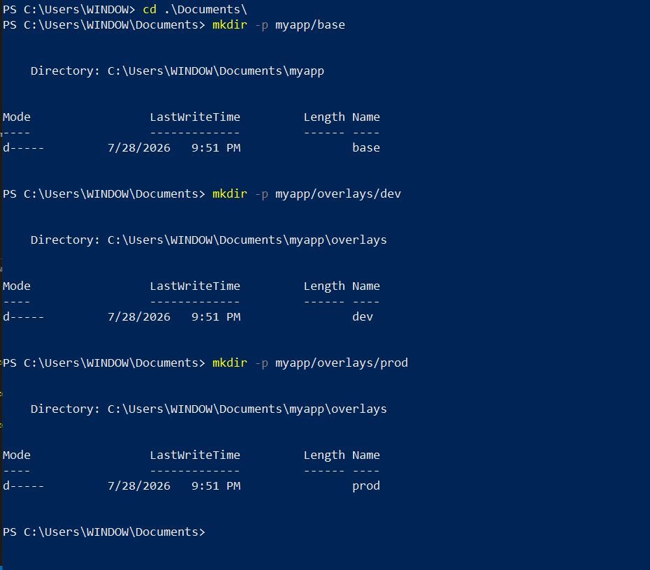
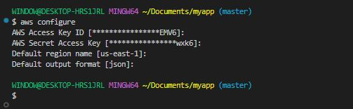
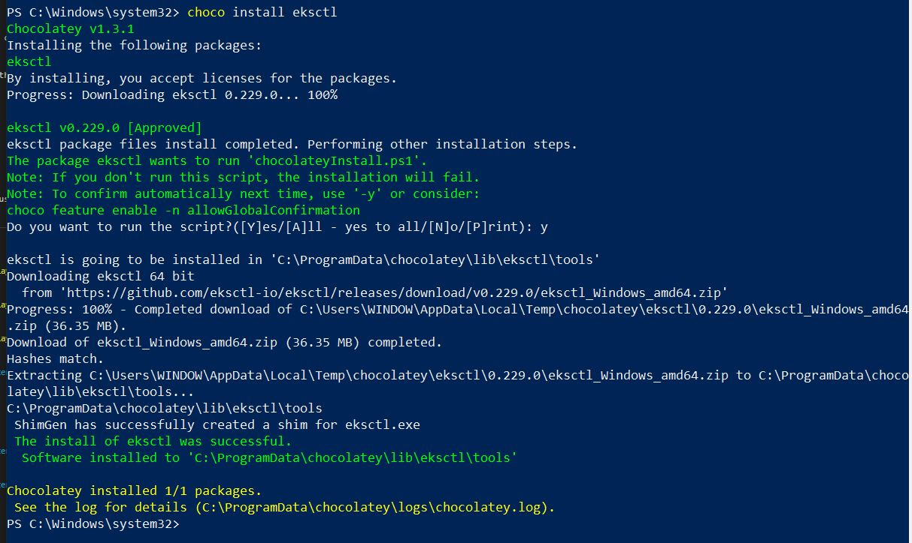
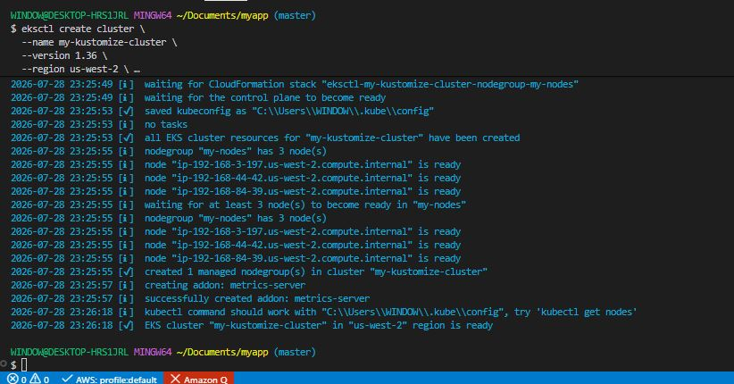
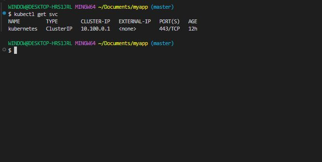
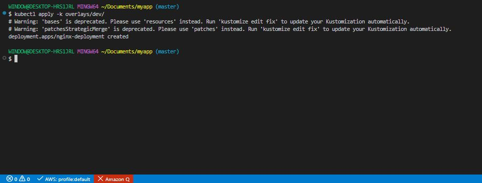
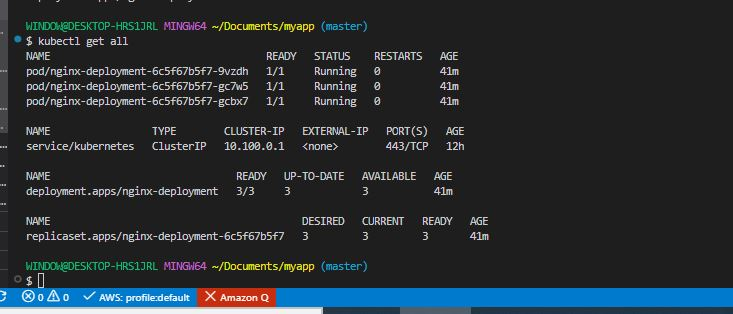
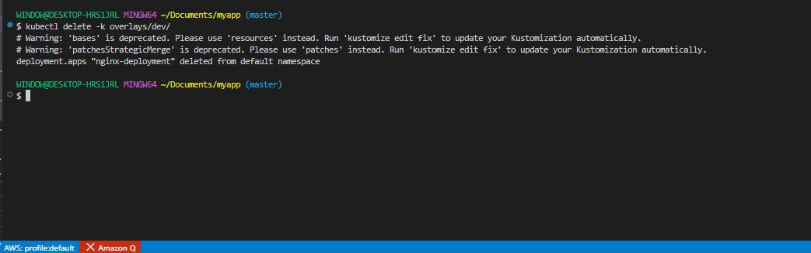
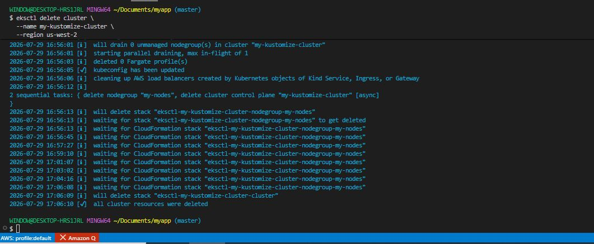

# Kustomize Fundamentals with AWS

## Project Overview

This project is designed to teach new learners about the basics of Kubernetes configuration management using Kustomize, with an emphasis on AWS as the cloud platform.

### Project Tasks

**Kustomize Structure and Concepts**

1. Understanding Kustomize Structure.

- Base Directory: Contains the common, default resources for your application.

- Overlays Directory: Contains environment-specific variations.

- Kustomization file: **'kustomization.yaml'**, used to declare the resources, bases, and ovverlays.

2. Key concepts:

- Resources: Kubernetes object manifests (e.g deployments, services)

- Bases: Starting point of a configuration, often the generic version.

- Overlays: Modifications or environment-specific settings applied to the base.

3. activity:

- Create a basic directory structure.

```bash
myapp/
├── base/
│   └── deployment.yaml
│   └── kustomization.yaml
└── overlays/
    ├── dev/
    │   └── kustomization.yaml
    └── prod/
        └── kustomization.yaml
```

- Populate **'deployment.yaml'** with a simple deployment manifest.

```bash
mkdir -p myapp/base
mkdir -p myapp/overlays/dev
mkdir -p myapp/overlays/prod
```



**Creating and managing Resources**

- Let's create **'myapp/base/deployment.yaml'**.

```bash
nano deployment.yaml
```

```bash
  apiVersion: apps/v1          # API version for the deployment object
kind: Deployment             # Specifies that this is a Deployment
metadata:
  name: nginx-deployment     # Name of the deployment
spec:                        # Specification of the deployment
  replicas: 2                # Number of replicas (pods running)
  selector:                  # Selector to identify the pods
    matchLabels:
      app: nginx
  template:                  # Template for the pod creation
    metadata:
      labels:
        app: nginx           # Label applied to the pod
    spec:
      containers:
        - name: nginx        # Name of the container
          image: nginx:1.14.2  # Docker image to use
          ports:
            - containerPort: 80  # Port the container will expose
```

- Include the Deployment in 'kustomization.yaml'.

```bash
cd ~/myapp/base
```

```bash
nano kustomization.yaml
```

```bash
apiVersion: kustomize.config.k8s.io/v1beta1
kind: Kustomization

resources:
  - deployment.yaml   # List of resource files to include in this configuration
```

**Basic Customization Techniques**

1. Create Overlays:

- Create two overlays: 'dev' and 'prod' in respective directories.

- Dev overlay ('overlays/dev/kustomization.yaml').

```bash
cd ~/myapp/overlays/dev
```

```bash
nano kustomization.yaml
```

```bash
bases:
  - ../../base          # Path to the base configuration directory
patchesStrategicMerge:
  - replica_count.yaml  # List of patches to apply to the base resources
```

- In 'overlays/dev/replica_count.yaml', define the patch:

```bash
nano replica_count.yaml
```

```bash
apiVersion: apps/v1     # API version for the deployment object
kind: Deployment        # Specifies that this is a Deployment
metadata:
  name: nginx-deployment  # Name of the deployment to patch
spec:
  replicas: 3           # Updating the number of replicas for the dev environment
```

- Using variables and placeholders:

Kustomize provides a way to customize Kubernetes manifests without modifying the original YAML files. Instead of relying heavily on templates, it uses overlays, patches, ConfigMaps, Secrets, and controlled variable substitution to support different environments such as development, testing, and production.

Variables and Placeholders in Kustomize

Unlike template-based tools such as Helm, Kustomize follows a declarative approach. It minimizes the use of placeholders and instead encourages defining values in Kubernetes resources that can be referenced or patched.

1. Variable Substitution

Kustomize supports variables by referencing values from Kubernetes resources, such as ConfigMaps or Services. These variables can then be substituted into selected fields of other resources.

Example:

```bash
configMapGenerator:
- name: app-config
  literals:
    - APP_NAME=my-app
```

A variable can then reference this ConfigMap value:

```bash
vars:
- name: APP_NAME
  objref:
    kind: ConfigMap
    name: app-config
    apiVersion: v1
  fieldref:
    fieldpath: data.APP_NAME
```

When Kustomize builds the manifests, $(APP_NAME) is replaced with my-app.

**Advantages of Kustomize Variables and Placeholders**

```bash
- Eliminates duplication by reusing a common base configuration.
- Supports multiple environments through overlays.
- Keeps Kubernetes manifests clean and declarative.
- Generates ConfigMaps and Secrets dynamically.
- Allows targeted customization using patches instead of maintaining multiple copies of manifests.
- Integrates directly with kubectl (kubectl apply -k) without requiring a separate templating engine.
```

**Limitations**

```bash
- Variable substitution is intentionally limited compared to Helm's templating language.
- Complex logic such as loops, conditional statements, or functions is not supported.
- Modern Kustomize emphasizes overlays and patches over extensive use of vars, making configurations easier to understand and maintain.
```

**Conclusion**

Kustomize enables dynamic configuration by combining variables, ConfigMap and Secret generators, overlays, and patches. Rather than relying on extensive placeholder substitution, it promotes reusable base manifests that can be customized for different deployment environments. This declarative approach simplifies configuration management, reduces duplication, and makes Kubernetes deployments more consistent and maintainable.

**Leveraging AWS**

Expanding on leveraging AWS, specifically Amazon EKS (Elastic Kubernetes Service), for deploying and testing the kustomize configurations requires a detailed step by step approach.

1. Set up the AWS account and CLI:

- Create an AWS account: If you don't have an AWS account already, create one on AWS management console. I have an account already.

2. Install AWS CLI:

- Download and install the AWS CLI from the official guide https://aws.amazon.com/cli/.

- Run the command:

```bash
aws configure
```



**Install and Configure 'eksctl'

'eksctl' is a simple CLI tool for creating clusters in EKS. It's the easiest way to get started with Amazon EKS.

- Follow the installation instructions on the https://github.com/eksctl-io/eksctl.

```bash
choco install eksctl
```



**Create an EKS Cluster**

1. Create a cluster:

- Run the following command to create a cluster

```bash
eksctl create cluster \
  --name my-kustomize-cluster \
  --version 1.36 \
  --region us-west-2 \
  --nodegroup-name my-nodes \
  --node-type t2.medium \
  --nodes 3
```



2. Verify Cluster Creation:


```bash
kubectl get svc
```



**Deploying Kustomize Configuration to EKS**

1. Prepare the Kustomize configuration.

- Ensure the kustomize configuration is ready in your project directory. This has been set up previously.

```bash
myapp/
├── base/
│   └── deployment.yaml
│   └── kustomization.yaml
└── overlays/
    ├── dev/
    │   └── kustomization.yaml
    └── prod/
        └── kustomization.yaml
```

2. Apply configuration to EKS.

- Select the appropriate overlay for the deployment.

- Run the following command from the root of the project directory:

```bash
kubectl apply -k overlays/dev/
```



This applies the configurations defined in the 'dev' overlay to EKS cluster.

**Verify Deployment**

1. Check deployed resources.

```bash
kubectl get all
```



2. To troubleshoot:

```bash
kubectl describe

kubectl logs
```

**Clean up Resources**

1. Delete deployed resources:

```bash
kubectl delete -k overlays/dev/
```


2. Delete the EKS Cluster:

```bash
eksctl delete cluster \
  --name my-kustomize-cluster \
  --region us-west-2
```



